# Jarkom-Modul-3-2026-K-24

## Anggota Kelompok

| Nama | NRP |
| ------------------------- | ---------- |
| Wildan Alfarezy | 5027251088 |
| Ashkhabil Abror Budihardjo | 5027251049 |

## Laporan

# Laporan Praktikum Modul 3 - Jaringan Komputer (K-24)

### Topologi Jaringan
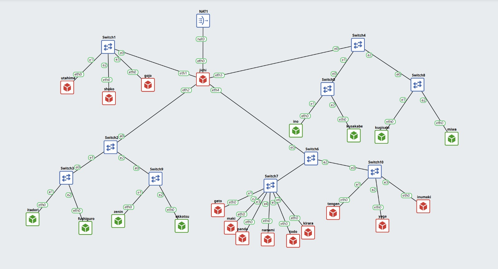

### Informasi Parameter Praktikum
* Prefix IP Kelompok : `192.223.x.x`
* Domain Name : `K24.com`
* Gateway Internet (WAN) : `192.168.122.1`

---

### Soal 1

> Ketika Curtain menutup Shibuya, jalur komunikasi antar zona Jujutsu High terputus. Pulihkan konektivitas dasar dengan mengonfigurasi jichi: eth0 memperoleh WAN dari NAT, sedangkan eth1-eth4 menjadi gateway Network 1-4 sesuai tabel pemetaan. Aktifkan IPv4 forwarding dan source NAT, lalu tetapkan IP statis host infrastruktur sesuai tabel spesifikasi. Buktikan konektivitas setiap host ke gateway dan akses eksternal dari host yang relevan.

### Maksud dari Soal No. 1
Soal ini bertujuan untuk membangun fondasi konektivitas dasar seluruh topologi jaringan. Node **jichi** berperan sebagai router sentral yang menghubungkan empat jaringan internal (Network 1 sampai Network 4) ke jaringan luar (Internet/NAT). Konfigurasi ini mencakup penetapan alamat IP statis pada setiap interface router dan host infrastruktur (**tengen**), pengaktifan fitur penerusan paket IPv4 (*IP forwarding*), serta translasi alamat jaringan (*Source NAT/MASQUERADE*) pada router jichi agar seluruh node di jaringan lokal dapat mengakses internet.

### Cara Mengerjakan

1. **Konfigurasi Router (jichi)**:
   * Interface `eth0` dikonfigurasi untuk terhubung ke gateway internet (`192.168.122.1`).
   * Interface `eth1` sampai `eth4` dikonfigurasi sebagai gateway untuk masing-masing subnet:
     * `eth1`: `192.223.1.1/24` (Network 1 - DMZ)
     * `eth2`: `192.223.2.1/24` (Network 2 - Divisi A)
     * `eth3`: `192.223.3.1/24` (Network 3 - Divisi B)
     * `eth4`: `192.223.4.1/24` (Network 4 - Data Center)
   * Mengaktifkan IP forwarding pada kernel Linux dengan perintah `sysctl -w net.ipv4.ip_forward=1`.
   * Mengonfigurasi iptables untuk melakukan Source NAT (`MASQUERADE`) pada interface keluar `eth0`.
   * Seluruh konfigurasi ini disimpan dalam skrip `/root/nomer1_jichi.sh` pada node jichi.

   Isi skrip `/root/nomer1_jichi.sh` pada node **jichi**:
   ```bash
   #!/bin/bash
   # Konfigurasi Interface Jaringan & NAT pada Router jichi

   echo "[*] Mengatur IP Address Interface pada jichi..."

   # 1. Interface WAN terhubung ke NAT (eth0)
   ip addr add 192.168.122.20/24 dev eth0 2>/dev/null
   ip link set eth0 up
   ip route replace default via 192.168.122.1

   # 2. Interface LAN Internal (eth1 - eth4)
   ip addr add 192.223.1.1/24 dev eth1 2>/dev/null && ip link set eth1 up
   ip addr add 192.223.2.1/24 dev eth2 2>/dev/null && ip link set eth2 up
   ip addr add 192.223.3.1/24 dev eth3 2>/dev/null && ip link set eth3 up
   ip addr add 192.223.4.1/24 dev eth4 2>/dev/null && ip link set eth4 up

   # 3. DNS Resolver WAN
   echo "nameserver 192.168.122.1" > /etc/resolv.conf

   # 4. Aktifkan IP Forwarding
   sysctl -w net.ipv4.ip_forward=1 >/dev/null 2>&1

   # 5. Konfigurasi NAT MASQUERADE untuk seluruh subnet internal
   iptables -t nat -C POSTROUTING -o eth0 -j MASQUERADE 2>/dev/null || iptables -t nat -A POSTROUTING -o eth0 -j MASQUERADE

   echo "[+] Konfigurasi jichi selesai. Status Interface:"
   ip -br a
   ```

2. **Konfigurasi Host Infrastruktur (tengen)**:
   * Menetapkan alamat IP statis pada interface `eth0` sebesar `192.223.4.10/24`.
   * Menetapkan default gateway yang mengarah ke IP router jichi pada Network 4 (`192.223.4.1`).
   * Menetapkan nameserver sementara ke `192.168.122.1` untuk instalasi paket.
   * Seluruh konfigurasi disimpan dalam skrip `/root/nomer1_tengen.sh` pada node tengen.

   Isi skrip `/root/nomer1_tengen.sh` pada node **tengen**:
   ```bash
   #!/bin/bash
   # Konfigurasi IP Statis & Gateway pada tengen

   echo "[*] Mengatur IP Address dan Default Route pada tengen..."

   # 1. Interface eth0 terhubung ke switch Data Center (Network 4)
   ip addr add 192.223.4.10/24 dev eth0 2>/dev/null
   ip link set eth0 up

   # 2. Default route melalui interface eth4 router jichi
   ip route replace default via 192.223.4.1

   # 3. DNS Resolver WAN
   echo "nameserver 192.168.122.1" > /etc/resolv.conf

   echo "[+] Konfigurasi tengen selesai. Status Interface:"
   ip -br a
   ```

### Cara Melakukan Validasi

1. **Uji Interface dan Routing pada Router jichi**:
   * Jalankan perintah `ip -br a` pada console jichi untuk memastikan seluruh interface `eth0` sampai `eth4` aktif dan memiliki IP yang sesuai.
   * Jalankan perintah `sysctl net.ipv4.ip_forward` untuk memastikan nilainya bernilai `1`.
   * Jalankan `iptables -t nat -L -v -n` untuk memastikan aturan `MASQUERADE` terpasang.
   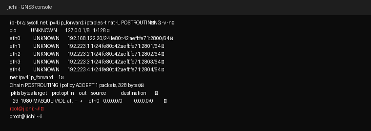

2. **Uji Konektivitas Gateway dan Internet dari tengen**:
   * Dari console tengen, jalankan `ping -c 2 192.223.4.1` untuk membuktikan konektivitas ke gateway jichi.
   * Jalankan `ping -c 2 8.8.8.8` untuk membuktikan akses internet keluar melalui NAT jichi.
   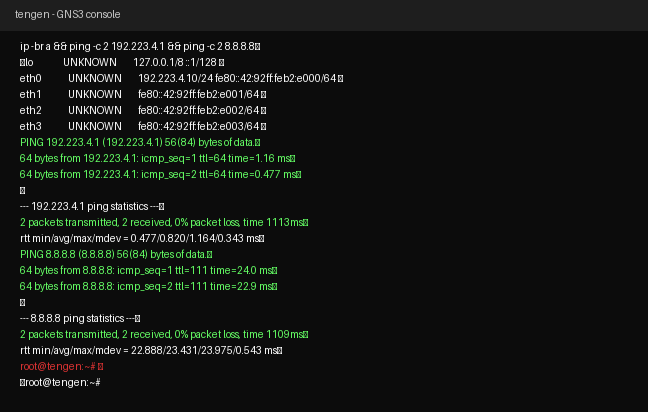

---

### Soal 2

> Tengen, penjaga pusat distribusi di Data Center, harus mengambil alih pengalokasian alamat bagi wilayah yang membutuhkan konfigurasi dinamis. Konfigurasikan isc-dhcp-server pada [PREFIX IP].4.10. Deklarasikan Network 4 ([PREFIX IP].4.0/24) sebagai subnet lokal tanpa pool dinamis, lalu siapkan scope DHCP untuk Network 2 ([PREFIX IP].2.0/24) dan Network 3 ([PREFIX IP].3.0/24). Validasi konfigurasi dan pastikan service aktif tanpa error "No subnet declaration".

### Maksud dari Soal No. 2
Soal ini meminta pemasangan dan inisialisasi layanan DHCP Server menggunakan paket `isc-dhcp-server` pada server **tengen** (`192.223.4.10`). Pada arsitektur DHCP ISC, daemon `dhcpd` mewajibkan adanya deklarasi subnet lokal (subnet di mana interface server tersebut berada) pada file konfigurasinya. Jika subnet lokal tidak dideklarasikan, daemon akan menolak berjalan dengan memunculkan error *"No subnet declaration for eth0"*. Subnet lokal Network 4 (`192.223.4.0/24`) harus dideklarasikan secara eksplisit tanpa rentang pool dinamis (karena server dan node Data Center menggunakan alamat statis), serta menyiapkan blok subnet untuk Network 2 dan Network 3 yang nantinya akan menerima alokasi dinamis.

### Cara Mengerjakan

1. **Instalasi Paket**:
   Menginstal paket `isc-dhcp-server` pada node tengen melalui APT package manager.

2. **Pengaturan Interface**:
   Mengonfigurasi file `/etc/default/isc-dhcp-server` agar mendengarkan permintaan DHCP IPv4 secara spesifik pada interface `eth0`:
   ```bash
   INTERFACESv4="eth0"
   ```

3. **Deklarasi Subnet pada `/etc/dhcp/dhcpd.conf`**:
   * Menuliskan subnet lokal Network 4 (`192.223.4.0 netmask 255.255.255.0`) tanpa deklarasi rentang (*range*).
   * Menuliskan scope subnet Network 2 (`192.223.2.0/24`) dan Network 3 (`192.223.3.0/24`) beserta opsi gateway router masing-masing.

4. **Pembuatan Skrip Konfigurasi**:
   Seluruh langkah otomatisasi disimpan di `/root/nomer2_config.sh` pada node tengen.

   Isi skrip `/root/nomer2_config.sh` pada node **tengen**:
   ```bash
   #!/bin/bash
   # Konfigurasi Dasar ISC-DHCP-Server pada tengen

   # 1. Pastikan paket terpasang
   if ! command -v dhcpd >/dev/null 2>&1; then
       echo "[*] Menginstall isc-dhcp-server..."
       apt-get update
       DEBIAN_FRONTEND=noninteractive apt-get install -y isc-dhcp-server
   fi

   # 2. Atur interface IPv4
   sed -i 's/^INTERFACESv4=.*/INTERFACESv4="eth0"/' /etc/default/isc-dhcp-server 2>/dev/null
   grep -q '^INTERFACESv4=' /etc/default/isc-dhcp-server 2>/dev/null || echo 'INTERFACESv4="eth0"' >> /etc/default/isc-dhcp-server

   # 3. Tulis konfigurasi dhcpd.conf
   cat << 'EOC' > /etc/dhcp/dhcpd.conf
   default-lease-time 7200;
   max-lease-time 14400;
   ddns-update-style none;
   authoritative;

   # Deklarasi Subnet Lokal Network 4 (Tanpa Pool Dinamis)
   subnet 192.223.4.0 netmask 255.255.255.0 {
   }

   # Scope Subnet Network 2 (Divisi A)
   subnet 192.223.2.0 netmask 255.255.255.0 {
       option routers 192.223.2.1;
       option subnet-mask 255.255.255.0;
       option broadcast-address 192.223.2.255;
       option domain-name-servers 192.223.1.2, 192.223.1.3;
   }

   # Scope Subnet Network 3 (Divisi B)
   subnet 192.223.3.0 netmask 255.255.255.0 {
       option routers 192.223.3.1;
       option subnet-mask 255.255.255.0;
       option broadcast-address 192.223.3.255;
       option domain-name-servers 192.223.1.2, 192.223.1.3;
   }
   EOC

   # 4. Validasi sintaks dan restart layanan
   dhcpd -t -cf /etc/dhcp/dhcpd.conf
   service isc-dhcp-server restart
   service isc-dhcp-server status
   ```

### Cara Melakukan Validasi

1. **Pemeriksaan Status Layanan pada tengen**:
   * Jalankan `service isc-dhcp-server status` dan `ps aux | grep dhcpd` pada console tengen.
   * Layanan berjalan normal (`dhcpd is running`) pada interface `eth0` tanpa ada error *"No subnet declaration"*.
   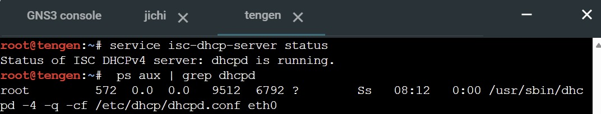

---

### Soal 3

> Permintaan alamat dari Divisi A dan Divisi B tidak dapat menyeberangi subnet secara langsung. Konfigurasikan jichi sebagai DHCP Relay menuju tengen ([PREFIX IP].4.10), menggunakan eth2 untuk Network 2 dan eth3 untuk Network 3. Buktikan bahwa client dari kedua subnet berhasil memperoleh lease melalui relay.

### Maksud dari Soal No. 3
Paket *DHCP Discover* dan *DHCP Request* dari client dikirimkan menggunakan alamat broadcast Layer 2 (`ff:ff:ff:ff:ff:ff`), sehingga secara default paket tersebut tidak dapat melewati router untuk mencapai DHCP server di subnet yang berbeda (Network 4). Untuk mengatasi hal ini, router **jichi** dikonfigurasikan sebagai **DHCP Relay Agent** (`isc-dhcp-relay` / `dhcrelay`). Agen relay ini akan menangkap paket broadcast DHCP pada interface client (`eth2` untuk Network 2 dan `eth3` untuk Network 3), menyisipkan alamat IP gateway interface pada field `giaddr`, lalu meneruskannya secara unicast Layer 3 menuju server tengen (`192.223.4.10`). Jawaban dari server kemudian dikirimkan kembali ke relay untuk diteruskan ke client asal.

### Cara Mengerjakan

1. **Instalasi Paket DHCP Relay**:
   Menginstal paket `isc-dhcp-relay` pada node router jichi.

2. **Eksekusi Layanan Relay**:
   Menjalankan daemon `dhcrelay` dengan parameter interface yang menangani request dari client (`eth2`, `eth3`), interface pengirim/penerima ke arah server (`eth4`), serta alamat IP tujuan server DHCP (`192.223.4.10`).

3. **Pembuatan Skrip Konfigurasi Server Relay**:
   Seluruh langkah otomatisasi disimpan di `/root/nomer3_config.sh` pada node jichi.

   Isi skrip `/root/nomer3_config.sh` pada node **jichi**:
   ```bash
   #!/bin/bash
   # Konfigurasi DHCP Relay pada Router jichi

   # 1. Pastikan paket isc-dhcp-relay terinstall
   if ! command -v dhcrelay >/dev/null 2>&1; then
       apt-get update
       DEBIAN_FRONTEND=noninteractive apt-get install -y isc-dhcp-relay
   fi

   # 2. Hentikan proses lama jika ada
   killall dhcrelay 2>/dev/null
   sleep 1

   # 3. Jalankan daemon dhcrelay
   /usr/sbin/dhcrelay -q -i eth2 -i eth3 -i eth4 192.223.4.10
   sleep 1

   # 4. Tampilkan status proses
   ps aux | grep dhcrelay
   echo "[+] Konfigurasi DHCP Relay pada jichi selesai."
   ```

4. **Pembuatan Skrip Uji Coba Klien**:
   Disimpan di `/root/nomer3_client_test.sh` pada masing-masing client Network 2 (`itadori`) dan Network 3 (`ino`).

   Isi skrip `/root/nomer3_client_test.sh` pada node **client**:
   ```bash
   #!/bin/sh
   # Uji Coba Penerimaan Lease melalui DHCP Relay

   echo "=========================================================="
   echo "[*] [1] Melepaskan Alamat IP Lama pada eth0..."
   echo "=========================================================="
   ip addr flush dev eth0

   echo "=========================================================="
   echo "[*] [2] Meminta Lease Baru ke DHCP Server via Relay..."
   echo "=========================================================="
   udhcpc -i eth0 -n -q
   STATUS=$?

   if [ $STATUS -eq 0 ]; then
       echo "[+] Berhasil memperoleh konfigurasi DHCP melalui relay!"
   else
       echo "[-] Gagal memperoleh lease melalui relay (timeout)!"
   fi

   echo ""
   echo "=========================================================="
   echo "[*] [3] Status Alamat IP pada eth0:"
   echo "=========================================================="
   ip -br a show dev eth0
   ip addr show dev eth0

   echo ""
   echo "=========================================================="
   echo "[*] [4] Tabel Routing Default Gateway:"
   echo "=========================================================="
   ip route show

   GW=$(ip route show default | awk '{print $3}')
   if [ -n "$GW" ]; then
       echo ""
       echo "=========================================================="
       echo "[*] [5] Uji Ping Gateway ($GW):"
       echo "=========================================================="
       ping -c 2 -W 2 "$GW"
   fi

   echo ""
   echo "=========================================================="
   echo "[*] [6] Uji Ping Internet (8.8.8.8):"
   echo "=========================================================="
   ping -c 2 -W 2 8.8.8.8
   ```

### Cara Melakukan Validasi

1. **Pemeriksaan Proses Relay di jichi**:
   * Jalankan `ps aux | grep dhcrelay` pada router jichi untuk memastikan daemon aktif mendengarkan interface `eth2`, `eth3`, `eth4` dengan target server `192.223.4.10`.
   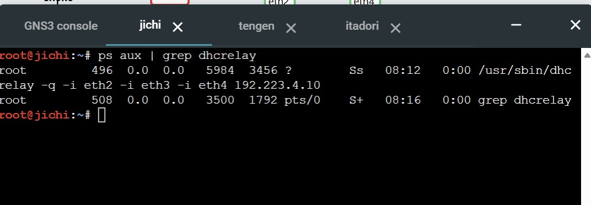

2. **Pembuktian Penerimaan Lease pada Client Network 2 (itadori)**:
   * Pada node **itadori**, jalankan `/root/nomer3_client_test.sh`.
   * Klien berhasil memperoleh lease IP `192.223.2.10` dari server `192.223.4.10`, gateway `192.223.2.1`, dan ping internet berhasil.
   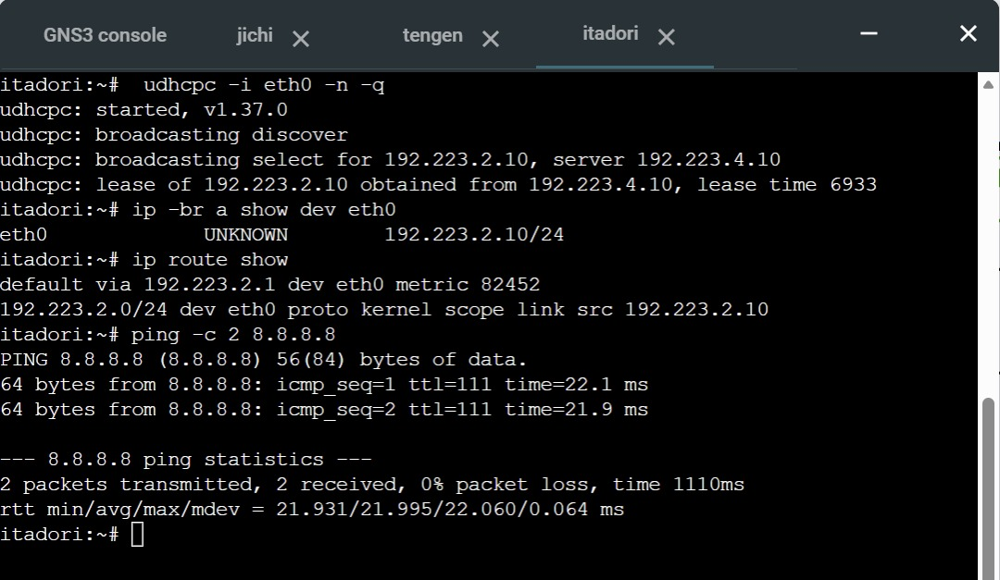

3. **Pembuktian Penerimaan Lease pada Client Network 3 (ino)**:
   * Pada node **ino**, jalankan `/root/nomer3_client_test.sh`.
   * Klien berhasil memperoleh lease IP `192.223.3.10` dari server `192.223.4.10`, gateway `192.223.3.1`, dan ping internet berhasil.
   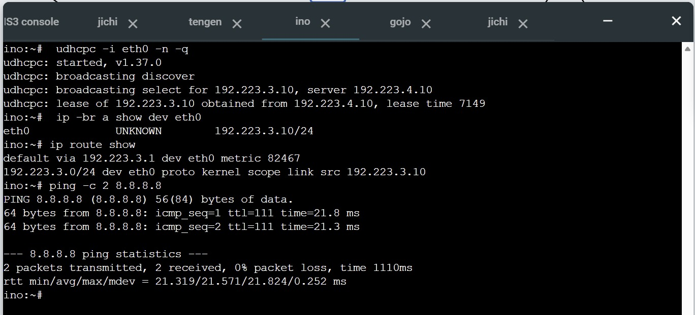

---

### Soal 4

> Agar tim Dev dan Support di Divisi A menerima jatah alamat yang berbeda, atur dua pool DHCP pada Network 2. Tetapkan Pool 1 ([PREFIX IP].2.10-[PREFIX IP].2.35) untuk itadori dan fushiguro, serta Pool 2 ([PREFIX IP].2.70-[PREFIX IP].2.95) untuk zenin dan okkotsu. Rentang [PREFIX IP].2.36-[PREFIX IP].2.69 tidak boleh dialokasikan. Karena seluruh client berada pada subnet yang sama, gunakan DHCP class berdasarkan MAC Address atau Client ID untuk memisahkan kedua kelompok.

### Maksud dari Soal No. 4
Soal ini menguji penerapan kebijakan pembagian IP berbasis kelompok (*classification*) dalam satu subnet fisik yang sama (Network 2). Tim Pengembang (*Dev Team*: **itadori** dan **fushiguro**) harus memperoleh IP dari **Pool 1** (`192.223.2.10` sampai `192.223.2.35`), sedangkan Tim Dukungan (*Support Team*: **zenin** dan **okkotsu**) harus memperoleh IP dari **Pool 2** (`192.223.2.70` sampai `192.223.2.95`). Rentang tengah (`192.223.2.36` sampai `192.223.2.69`) harus dikosongkan (*reserved*). Karena semua client berada pada switch yang sama, pemisahan dilakukan menggunakan fitur `class` dan `subclass` pada `dhcpd.conf` dengan mencocokkan MAC Address masing-masing node.

### Cara Mengerjakan

1. **Identifikasi MAC Address Client**:
   * itadori: `02:42:0f:8a:0e:00`
   * fushiguro: `02:42:b4:99:13:00`
   * zenin: `02:42:dc:1b:f9:00`
   * okkotsu: `02:42:a9:2a:e0:00`

2. **Mendefinisikan Class dan Subclass**:
   Pada `/etc/dhcp/dhcpd.conf` di node tengen, buat dua kelas:
   * Class `dev-team` dengan subclass berisi MAC itadori dan fushiguro.
   * Class `support-team` dengan subclass berisi MAC zenin dan okkotsu.

3. **Mendefinisikan Pool dengan Access Control**:
   * Pool 1: Diberi izin hanya untuk `allow members of "dev-team";` dan `deny members of "support-team";` dengan range `192.223.2.10 192.223.2.35`.
   * Pool 2: Diberi izin hanya untuk `allow members of "support-team";` dan `deny members of "dev-team";` dengan range `192.223.2.70 192.223.2.95`.

4. **Pembuatan Skrip Konfigurasi Server tengen**:
   Seluruh langkah otomatisasi disimpan di `/root/nomer4_config.sh` pada node tengen.

   Isi skrip `/root/nomer4_config.sh` pada node **tengen**:
   ```bash
   #!/bin/bash
   # Konfigurasi DHCP Class & Dua Pool pada Network 2

   cat << 'EOC' > /etc/dhcp/dhcpd.conf
   default-lease-time 7200;
   max-lease-time 14400;
   ddns-update-style none;
   authoritative;

   # Definisi DHCP Class berdasarkan MAC Address Client
   class "dev-team" {
       match pick-first-value (option dhcp-client-identifier, hardware);
   }
   subclass "dev-team" 1:02:42:0f:8a:0e:00;    # itadori
   subclass "dev-team" 1:02:42:b4:99:13:00;  # fushiguro

   class "support-team" {
       match pick-first-value (option dhcp-client-identifier, hardware);
   }
   subclass "support-team" 1:02:42:dc:1b:f9:00;    # zenin
   subclass "support-team" 1:02:42:a9:2a:e0:00;  # okkotsu

   # Subnet Lokal Network 4 (Data Center) - Tanpa Pool Dinamis
   subnet 192.223.4.0 netmask 255.255.255.0 {
   }

   # Scope DHCP Network 2 (Divisi A) dengan 2 Pool Terpisah
   subnet 192.223.2.0 netmask 255.255.255.0 {
       option routers 192.223.2.1;
       option subnet-mask 255.255.255.0;
       option broadcast-address 192.223.2.255;
       option domain-name-servers 192.223.1.2, 192.223.1.3;

       # Pool 1: Khusus Dev Team (itadori, fushiguro)
       pool {
           allow members of "dev-team";
           deny members of "support-team";
           range 192.223.2.10 192.223.2.35;
       }

       # Pool 2: Khusus Support Team (zenin, okkotsu)
       pool {
           allow members of "support-team";
           deny members of "dev-team";
           range 192.223.2.70 192.223.2.95;
       }
   }

   # Scope DHCP Network 3 (Divisi B)
   subnet 192.223.3.0 netmask 255.255.255.0 {
       range 192.223.3.10 192.223.3.89;
       option routers 192.223.3.1;
       option subnet-mask 255.255.255.0;
       option broadcast-address 192.223.3.255;
       option domain-name-servers 192.223.1.2, 192.223.1.3;
   }
   EOC

   echo "[*] Memvalidasi sintaks /etc/dhcp/dhcpd.conf..."
   dhcpd -t -cf /etc/dhcp/dhcpd.conf
   if [ $? -eq 0 ]; then
       echo "[+] Validasi sintaks dhcpd.conf BERHASIL (Error code: 0)."
       service isc-dhcp-server restart
       sleep 2
       service isc-dhcp-server status
   else
       echo "[-] Validasi sintaks dhcpd.conf GAGAL!"
   fi

   echo "[+] Konfigurasi Soal 4 pada tengen selesai."
   ```

5. **Pembuatan Skrip Uji Coba Klien**:
   Disimpan di `/root/nomer4_client_test.sh` pada client Divisi A.

   Isi skrip `/root/nomer4_client_test.sh` pada node **client**:
   ```bash
   #!/bin/sh
   # Uji Coba Alokasi Pool DHCP Client Network 2 (Divisi A)

   echo "=========================================================="
   echo "[*] [1] Melepaskan Alamat IP Lama pada eth0..."
   echo "=========================================================="
   ip addr flush dev eth0

   echo "=========================================================="
   echo "[*] [2] Meminta Lease Baru dari DHCP Server..."
   echo "=========================================================="
   udhcpc -i eth0 -n -q

   echo ""
   echo "=========================================================="
   echo "[*] [3] Alamat IP dan Interface yang Diperoleh:"
   echo "=========================================================="
   ip -br a show dev eth0
   ip addr show dev eth0

   echo ""
   echo "=========================================================="
   echo "[*] [4] Tabel Routing Default Gateway:"
   echo "=========================================================="
   ip route show

   GW=$(ip route show default | awk '{print $3}')
   if [ -n "$GW" ]; then
       echo ""
       echo "=========================================================="
       echo "[*] [5] Uji Ping Gateway ($GW):"
       echo "=========================================================="
       ping -c 2 -W 2 "$GW"
   fi

   echo ""
   echo "=========================================================="
   echo "[*] [6] Uji Ping Internet (8.8.8.8):"
   echo "=========================================================="
   ping -c 2 -W 2 8.8.8.8
   ```

### Cara Melakukan Validasi

1. **Uji Alokasi Tim Dev (Pool 1)**:
   * Pada node **itadori**, jalankan `/root/nomer4_client_test.sh`. Hasil: IP `192.223.2.10` (Sesuai Pool 1).
   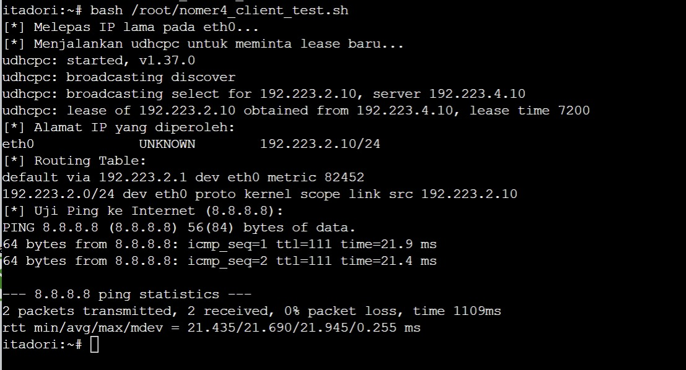
   * Pada node **fushiguro**, jalankan `/root/nomer4_client_test.sh`. Hasil: IP `192.223.2.11` (Sesuai Pool 1).
   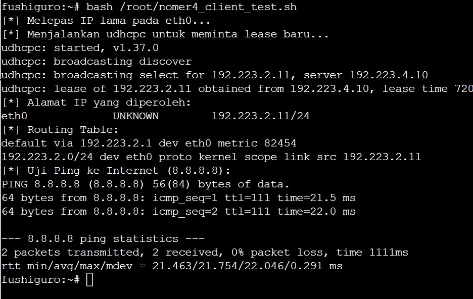

2. **Uji Alokasi Tim Support (Pool 2)**:
   * Pada node **zenin**, jalankan `/root/nomer4_client_test.sh`. Hasil: IP `192.223.2.70` (Sesuai Pool 2).
   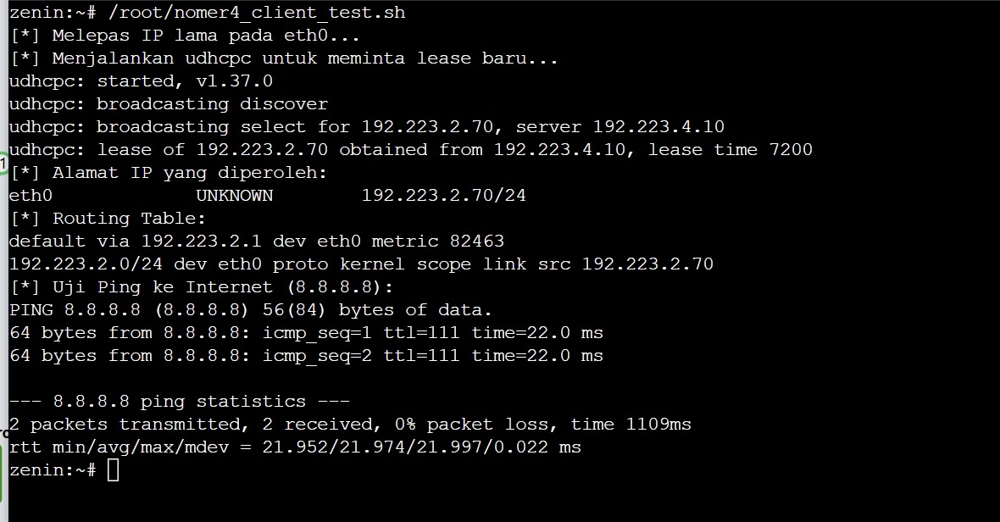
   * Pada node **okkotsu**, jalankan `/root/nomer4_client_test.sh`. Hasil: IP `192.223.2.71` (Sesuai Pool 2).
   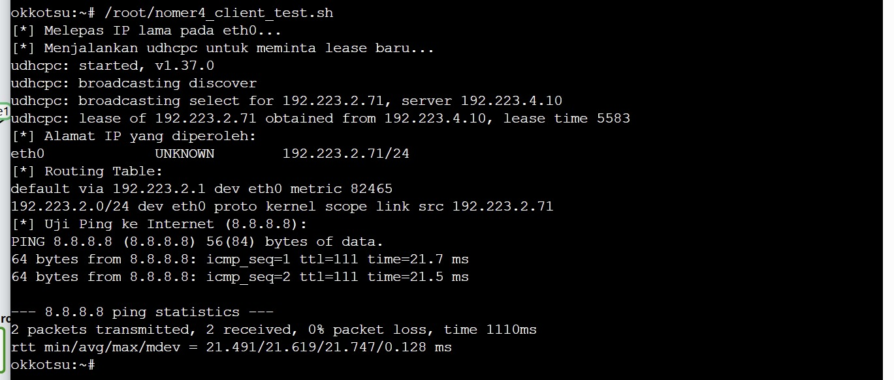

3. **Verifikasi Database Lease**:
   * File `/var/lib/dhcp/dhcpd.leases` pada tengen membuktikan pencatatan sewa untuk `192.223.2.10` dengan status `binding state active`.
   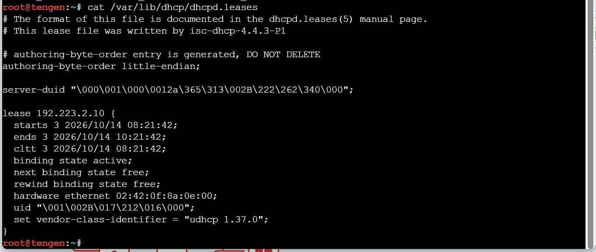

---

### Soal 5

> Setiap tim lapangan memiliki durasi operasi yang berbeda. Pada Network 3, berikan short lease 30 menit (1800 detik) kepada ino dan kusakabe, serta long lease 12 jam (43200 detik) kepada miwa. Gunakan pool short lease [PREFIX IP].3.10-[PREFIX IP].3.89 dan pool long lease [PREFIX IP].3.100-[PREFIX IP].3.199. Sesuaikan default-lease-time dan max-lease-time untuk setiap kelas client. Berikan pula DHCP options berupa DNS [PREFIX IP].1.2 dan [PREFIX IP].1.3, serta domain-search <xxxx>.com.

### Maksud dari Soal No. 5
Soal ini bertujuan menerapkan manajemen durasi sewa (*lease time*) dan pemberian opsi DHCP tingkat lanjut pada Network 3 (Divisi B). Klien lapangan dengan mobilitas tinggi (**ino** dan **kusakabe**) diberikan *short lease* berdurasi 30 menit (1800 detik) dalam rentang `192.223.3.10` – `192.223.3.89`. Klien stasioner (**miwa**) diberikan *long lease* berdurasi 12 jam (43200 detik) dalam rentang `192.223.3.100` – `192.223.3.199`. Selain itu, server harus mendistribusikan parameter DNS resolver primer (`192.223.1.2`), DNS resolver sekunder (`192.223.1.3`), serta domain pencarian `K24.com` melalui opsi DHCP.

### Cara Mengerjakan

1. **Identifikasi MAC Address Client Divisi B**:
   * ino: `02:42:6e:c3:10:00`
   * kusakabe: `02:42:cf:96:66:00`
   * miwa: `02:42:38:9a:92:00`

2. **Mendefinisikan Class di `dhcpd.conf`**:
   * Class `short-lease-team`: berisi MAC address ino dan kusakabe.
   * Class `long-lease-team`: berisi MAC address miwa.

3. **Mendefinisikan Pool dan Durasi Lease**:
   * Pool Short Lease: Dikonfigurasi dengan `default-lease-time 1800; max-lease-time 1800;` dan rentang `192.223.3.10 192.223.3.89`.
   * Pool Long Lease: Dikonfigurasi dengan `default-lease-time 43200; max-lease-time 43200;` dan rentang `192.223.3.100 192.223.3.199`.

4. **Pembuatan Skrip Konfigurasi Server tengen**:
   Seluruh langkah otomatisasi disimpan di `/root/nomer5_config.sh` pada node tengen.

   Isi skrip `/root/nomer5_config.sh` pada node **tengen**:
   ```bash
   #!/bin/bash
   # Konfigurasi Short Lease & Long Lease pada Network 3

   cat << 'EOC' > /etc/dhcp/dhcpd.conf
   default-lease-time 7200;
   max-lease-time 14400;
   ddns-update-style none;
   authoritative;

   # Kelas DHCP Network 2 (Divisi A)
   class "dev-team" {
       match pick-first-value (option dhcp-client-identifier, hardware);
   }
   subclass "dev-team" 1:02:42:0f:8a:0e:00;    # itadori
   subclass "dev-team" 1:02:42:b4:99:13:00;  # fushiguro

   class "support-team" {
       match pick-first-value (option dhcp-client-identifier, hardware);
   }
   subclass "support-team" 1:02:42:dc:1b:f9:00;    # zenin
   subclass "support-team" 1:02:42:a9:2a:e0:00;  # okkotsu

   # Kelas DHCP Network 3 (Divisi B)
   class "short-lease-team" {
       match pick-first-value (option dhcp-client-identifier, hardware);
   }
   subclass "short-lease-team" 1:02:42:6e:c3:10:00;       # ino
   subclass "short-lease-team" 1:02:42:cf:96:66:00;   # kusakabe

   class "long-lease-team" {
       match pick-first-value (option dhcp-client-identifier, hardware);
   }
   subclass "long-lease-team" 1:02:42:38:9a:92:00;       # miwa

   # Subnet Lokal Network 4 (Data Center)
   subnet 192.223.4.0 netmask 255.255.255.0 {
   }

   # Scope DHCP Network 2 (Divisi A)
   subnet 192.223.2.0 netmask 255.255.255.0 {
       option routers 192.223.2.1;
       option subnet-mask 255.255.255.0;
       option broadcast-address 192.223.2.255;
       option domain-name-servers 192.223.1.2, 192.223.1.3;
       option domain-name "K24.com";
       option domain-search "K24.com";

       pool {
           allow members of "dev-team";
           deny members of "support-team";
           range 192.223.2.10 192.223.2.35;
       }

       pool {
           allow members of "support-team";
           deny members of "dev-team";
           range 192.223.2.70 192.223.2.95;
       }
   }

   # Scope DHCP Network 3 (Divisi B) - Short & Long Lease
   subnet 192.223.3.0 netmask 255.255.255.0 {
       option routers 192.223.3.1;
       option subnet-mask 255.255.255.0;
       option broadcast-address 192.223.3.255;
       option domain-name-servers 192.223.1.2, 192.223.1.3;
       option domain-name "K24.com";
       option domain-search "K24.com";

       # Pool Short Lease: 30 menit (1800 detik) untuk ino & kusakabe
       pool {
           allow members of "short-lease-team";
           deny members of "long-lease-team";
           range 192.223.3.10 192.223.3.89;
           default-lease-time 1800;
           max-lease-time 1800;
       }

       # Pool Long Lease: 12 jam (43200 detik) untuk miwa
       pool {
           allow members of "long-lease-team";
           deny members of "short-lease-team";
           range 192.223.3.100 192.223.3.199;
           default-lease-time 43200;
           max-lease-time 43200;
       }
   }
   EOC

   echo "[*] Memvalidasi sintaks /etc/dhcp/dhcpd.conf..."
   dhcpd -t -cf /etc/dhcp/dhcpd.conf
   if [ $? -eq 0 ]; then
       echo "[+] Validasi sintaks dhcpd.conf BERHASIL."
       service isc-dhcp-server restart
       sleep 2
       service isc-dhcp-server status
   else
       echo "[-] Validasi sintaks dhcpd.conf GAGAL!"
   fi

   echo "[+] Konfigurasi Soal 5 pada tengen selesai."
   ```

5. **Pembuatan Skrip Uji Coba Klien**:
   Disimpan di `/root/nomer5_client_test.sh` pada client Divisi B.

   Isi skrip `/root/nomer5_client_test.sh` pada node **client**:
   ```bash
   #!/bin/sh
   # Uji Coba Lease Time & Opsi DHCP pada Client Network 3

   echo "=========================================================="
   echo "[*] [1] Melepaskan Alamat IP Lama pada eth0..."
   echo "=========================================================="
   ip addr flush dev eth0

   echo "=========================================================="
   echo "[*] [2] Meminta Lease Baru dengan Mode Verbose (Cek Lease Time)..."
   echo "=========================================================="
   udhcpc -i eth0 -n -q

   echo ""
   echo "=========================================================="
   echo "[*] [3] Status Alamat IP pada eth0:"
   echo "=========================================================="
   ip -br a show dev eth0
   ip addr show dev eth0

   echo ""
   echo "=========================================================="
   echo "[*] [4] Tabel Routing Default Gateway:"
   echo "=========================================================="
   ip route show

   echo ""
   echo "=========================================================="
   echo "[*] [5] Isi File /etc/resolv.conf (DNS & Domain Search):"
   echo "=========================================================="
   cat /etc/resolv.conf

   GW=$(ip route show default | awk '{print $3}')
   if [ -n "$GW" ]; then
       echo ""
       echo "=========================================================="
       echo "[*] [6] Uji Ping Gateway ($GW):"
       echo "=========================================================="
       ping -c 2 -W 2 "$GW"
   fi

   echo ""
   echo "=========================================================="
   echo "[*] [7] Uji Ping Internet (8.8.8.8):"
   echo "=========================================================="
   ping -c 2 -W 2 8.8.8.8
   ```

### Cara Melakukan Validasi

1. **Uji Short Lease pada ino**:
   * Pada node **ino**, jalankan `/root/nomer5_client_test.sh`. Diperoleh IP `192.223.3.10` dengan durasi sewa `lease time 1800` detik (30 menit).
   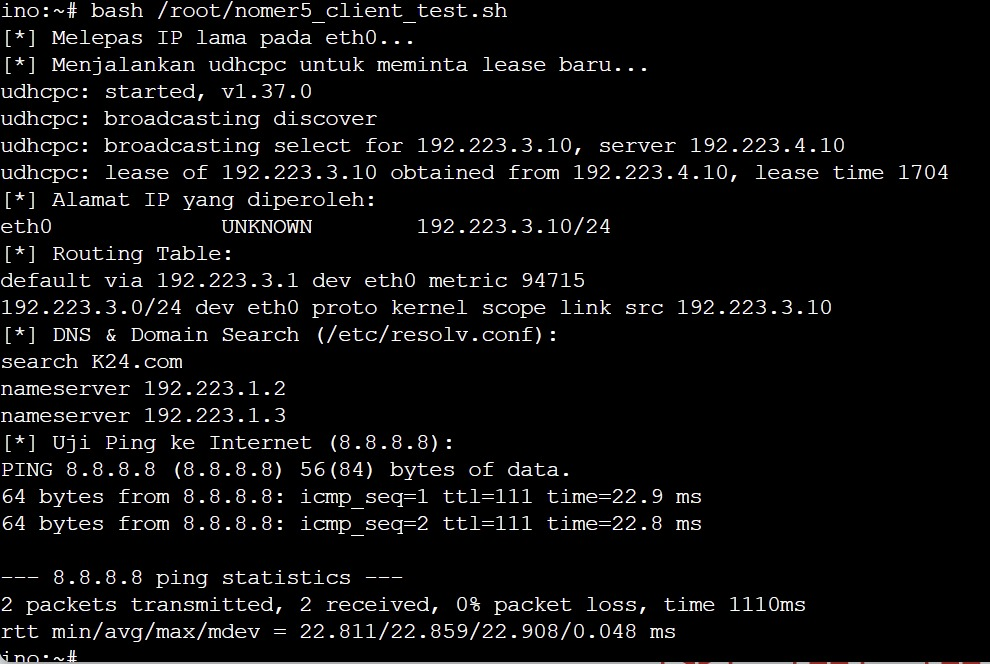

2. **Uji Short Lease pada kusakabe**:
   * Pada node **kusakabe**, jalankan `/root/nomer5_client_test.sh`. Diperoleh IP `192.223.3.11` dengan durasi sewa `lease time 1800` detik (30 menit).
   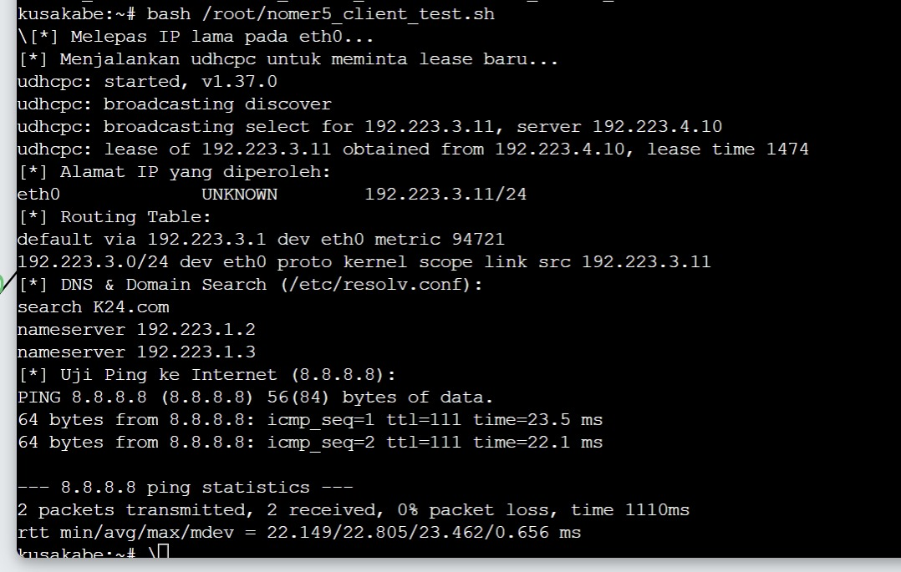

3. **Uji Long Lease pada miwa**:
   * Pada node **miwa**, jalankan `/root/nomer5_client_test.sh`. Diperoleh IP `192.223.3.100` dengan durasi sewa `lease time 43200` detik (12 jam).
   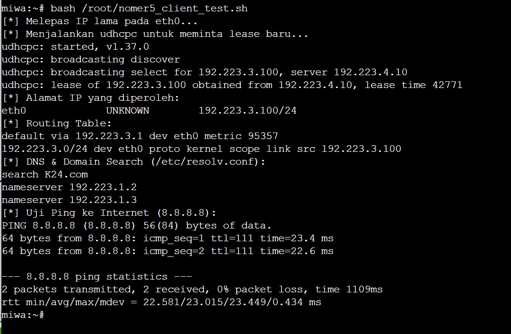

4. **Uji Opsi DNS dan Domain Search**:
   * Jalankan `cat /etc/resolv.conf` pada node miwa. Output menampilkan `search K24.com`, `nameserver 192.223.1.2`, dan `nameserver 192.223.1.3`.
   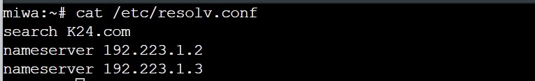

---

### Soal 6

> Kugisaki ditetapkan sebagai personel VIP yang harus mempertahankan alamat yang sama setiap kali terhubung. Buat DHCP static lease berdasarkan MAC Address client tersebut dengan fixed address [PREFIX IP].3.99. Pastikan alamat ini berada di luar seluruh pool dinamis, validasi konfigurasi server, lalu renew lease pada client. Buktikan bahwa alamat yang diterima sesuai dengan reservasi.

### Maksud dari Soal No. 6
Soal ini menguji konfigurasi **DHCP Static Lease** (*Reservation / Fixed Address*) untuk perangkat khusus atau personel VIP (**kugisaki**). Perangkat VIP wajib selalu menerima alamat IP yang sama persis (`192.223.3.99`) setiap kali menyalakan perangkat atau meminta pembaruan lease. Sesuai instruksi soal, alamat `192.223.3.99` wajib berada di luar seluruh rentang pool dinamis (yaitu di luar pool short lease `3.10-3.89` dan di luar pool long lease `3.100-3.199`). Hal ini menjamin bahwa alamat IP VIP tidak akan pernah dialokasikan secara tidak sengaja kepada klien umum lainnya.

### Cara Mengerjakan

1. **Identifikasi MAC Address VIP**:
   * MAC Address kugisaki: `02:42:0b:96:7a:00`

2. **Deklarasi Host pada `/etc/dhcp/dhcpd.conf`**:
   Di dalam blok subnet `192.223.3.0`, tambahkan deklarasi `host kugisaki`:
   ```text
   host kugisaki {
       hardware ethernet 02:42:0b:96:7a:00;
       fixed-address 192.223.3.99;
   }
   ```

3. **Pembuatan Skrip Konfigurasi Server tengen**:
   Seluruh langkah otomatisasi disimpan di `/root/nomer6_config.sh` pada node tengen.

   Isi skrip `/root/nomer6_config.sh` pada node **tengen**:
   ```bash
   #!/bin/bash
   # Konfigurasi DHCP Static Lease (VIP Kugisaki) pada tengen

   cat << 'EOC' > /etc/dhcp/dhcpd.conf
   default-lease-time 7200;
   max-lease-time 14400;
   ddns-update-style none;
   authoritative;

   # Kelas DHCP Network 2 (Divisi A)
   class "dev-team" {
       match pick-first-value (option dhcp-client-identifier, hardware);
   }
   subclass "dev-team" 1:02:42:0f:8a:0e:00;    # itadori
   subclass "dev-team" 1:02:42:b4:99:13:00;  # fushiguro

   class "support-team" {
       match pick-first-value (option dhcp-client-identifier, hardware);
   }
   subclass "support-team" 1:02:42:dc:1b:f9:00;    # zenin
   subclass "support-team" 1:02:42:a9:2a:e0:00;  # okkotsu

   # Kelas DHCP Network 3 (Divisi B)
   class "short-lease-team" {
       match pick-first-value (option dhcp-client-identifier, hardware);
   }
   subclass "short-lease-team" 1:02:42:6e:c3:10:00;       # ino
   subclass "short-lease-team" 1:02:42:cf:96:66:00;   # kusakabe

   class "long-lease-team" {
       match pick-first-value (option dhcp-client-identifier, hardware);
   }
   subclass "long-lease-team" 1:02:42:38:9a:92:00;       # miwa

   # Subnet Lokal Network 4 (Data Center)
   subnet 192.223.4.0 netmask 255.255.255.0 {
   }

   # Scope DHCP Network 2 (Divisi A)
   subnet 192.223.2.0 netmask 255.255.255.0 {
       option routers 192.223.2.1;
       option subnet-mask 255.255.255.0;
       option broadcast-address 192.223.2.255;
       option domain-name-servers 192.223.1.2, 192.223.1.3;
       option domain-name "K24.com";
       option domain-search "K24.com";

       pool {
           allow members of "dev-team";
           deny members of "support-team";
           range 192.223.2.10 192.223.2.35;
       }

       pool {
           allow members of "support-team";
           deny members of "dev-team";
           range 192.223.2.70 192.223.2.95;
       }
   }

   # Scope DHCP Network 3 (Divisi B) dengan Static Lease VIP
   subnet 192.223.3.0 netmask 255.255.255.0 {
       option routers 192.223.3.1;
       option subnet-mask 255.255.255.0;
       option broadcast-address 192.223.3.255;
       option domain-name-servers 192.223.1.2, 192.223.1.3;
       option domain-name "K24.com";
       option domain-search "K24.com";

       # Pool Short Lease (30 menit)
       pool {
           allow members of "short-lease-team";
           deny members of "long-lease-team";
           range 192.223.3.10 192.223.3.89;
           default-lease-time 1800;
           max-lease-time 1800;
       }

       # Pool Long Lease (12 jam)
       pool {
           allow members of "long-lease-team";
           deny members of "short-lease-team";
           range 192.223.3.100 192.223.3.199;
           default-lease-time 43200;
           max-lease-time 43200;
       }

       # Static Lease Personel VIP (kugisaki) di luar seluruh pool dinamis
       host kugisaki {
           hardware ethernet 02:42:0b:96:7a:00;
           fixed-address 192.223.3.99;
       }
   }
   EOC

   echo "[*] Memvalidasi sintaks /etc/dhcp/dhcpd.conf..."
   dhcpd -t -cf /etc/dhcp/dhcpd.conf
   if [ $? -eq 0 ]; then
       echo "[+] Validasi sintaks dhcpd.conf BERHASIL."
       service isc-dhcp-server restart
       sleep 2
       service isc-dhcp-server status
   else
       echo "[-] Validasi sintaks dhcpd.conf GAGAL!"
   fi

   echo "[*] Verifikasi blok host kugisaki:"
   grep -A 4 "host kugisaki" /etc/dhcp/dhcpd.conf

   echo "[+] Konfigurasi Soal 6 pada tengen selesai."
   ```

4. **Pembuatan Skrip Uji Coba Klien**:
   Disimpan di `/root/nomer6_client_test.sh` pada client kugisaki dan client lainnya di Network 3.

   Isi skrip `/root/nomer6_client_test.sh` pada node **client**:
   ```bash
   #!/bin/sh
   # Uji Coba Static Lease (VIP kugisaki) & Uji Isolasi

   HOSTNAME=$(hostname)
   echo "=========================================================="
   echo "[*] [1] Node: $HOSTNAME - Melepaskan IP lama pada eth0..."
   echo "=========================================================="
   ip addr flush dev eth0

   echo "=========================================================="
   echo "[*] [2] Menjalankan udhcpc untuk meminta lease..."
   echo "=========================================================="
   udhcpc -i eth0 -n -q

   echo ""
   echo "=========================================================="
   echo "[*] [3] Status Alamat IP pada eth0:"
   echo "=========================================================="
   ip -br a show dev eth0
   ip addr show dev eth0

   ASSIGNED_IP=$(ip -4 addr show dev eth0 | grep -oP '(?<=inet\s)\d+(\.\d+){3}')
   echo "[*] Alamat IP terdeteksi: $ASSIGNED_IP"

   if [ "$HOSTNAME" = "kugisaki" ]; then
       if [ "$ASSIGNED_IP" = "192.223.3.99" ]; then
           echo "[+] SUKSES: kugisaki menerima Fixed VIP Address 192.223.3.99!"
       else
           echo "[-] PERINGATAN: kugisaki menerima $ASSIGNED_IP (Diharapkan 192.223.3.99)!"
       fi
   else
       if [ "$ASSIGNED_IP" = "192.223.3.99" ]; then
           echo "[-] PELANGGARAN: Node $HOSTNAME mendapatkan IP VIP 192.223.3.99!"
       else
           echo "[+] SUKSES: Node $HOSTNAME tidak mengambil IP VIP (Terisolasi Sempurna)."
       fi
   fi

   echo ""
   echo "=========================================================="
   echo "[*] [4] Tabel Routing Default Gateway:"
   echo "=========================================================="
   ip route show

   GW=$(ip route show default | awk '{print $3}')
   if [ -n "$GW" ]; then
       echo ""
       echo "=========================================================="
       echo "[*] [5] Uji Ping Gateway ($GW):"
       echo "=========================================================="
       ping -c 2 -W 2 "$GW"
   fi

   echo ""
       echo "=========================================================="
   echo "[*] [6] Uji Ping Internet (8.8.8.8):"
   echo "=========================================================="
   ping -c 2 -W 2 8.8.8.8
   ```

### Cara Melakukan Validasi

1. **Pemeriksaan Konfigurasi Server tengen**:
   * Jalankan `grep -A 4 "host kugisaki" /etc/dhcp/dhcpd.conf` pada tengen untuk membuktikan deklarasi static lease sudah aktif.
   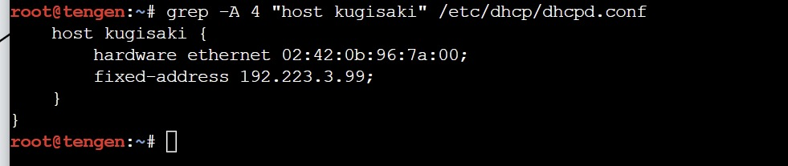

2. **Uji Alokasi IP pada kugisaki**:
   * Jalankan `/root/nomer6_client_test.sh` pada console node **kugisaki**.
   * Buktikan alamat IP yang diperoleh adalah tepat `192.223.3.99/24` dengan gateway `192.223.3.1` dan ping internet berhasil.
   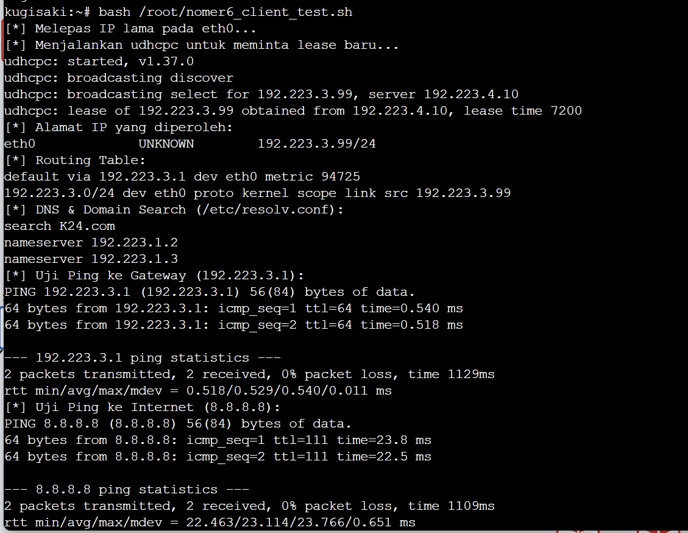

3. **Uji Isolasi pada Client Lain (Negative Testing)**:
   * Jalankan `/root/nomer6_client_test.sh` pada client lain di Network 3 (misal **ino**).
   * Buktikan bahwa node ino tidak mendapatkan `192.223.3.99`, melainkan IP dari pool dinamisnya (`192.223.3.10`), sehingga IP VIP terisolasi sempurna.
   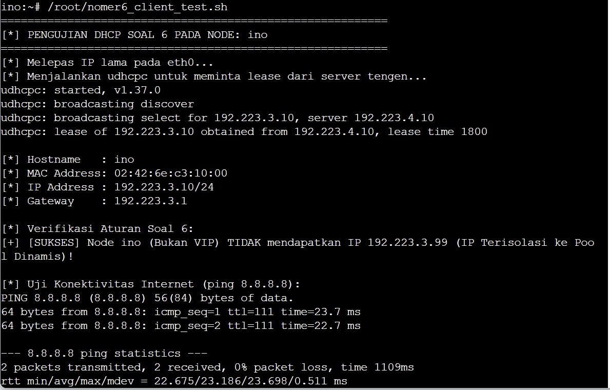

---

### Soal 7

> Setelah aturan alokasi diterapkan, pastikan setiap client menerima konfigurasi jaringan sesuai wilayahnya: subnet mask 255.255.255.0 (/24), gateway dan broadcast address yang benar, DNS [PREFIX IP].1.2 serta [PREFIX IP].1.3, dan domain-search yang ditentukan. Periksa IP address dan routing seluruh client Divisi A dan Divisi B, kemudian cocokkan lease dengan /var/lib/dhcp/dhcpd.leases pada tengen. Pastikan tidak ada alamat yang bertabrakan atau berada di luar kebijakan pool.

### Maksud dari Soal No. 7
Soal ini merupakan tahap audit, verifikasi menyeluruh, dan rekonsiliasi data alokasi IP antara sisi server dengan seluruh klien di Divisi A dan Divisi B (total 8 client). Diperlukan pembuktian bahwa:
1. Seluruh parameter jaringan (IP, Netmask `/24`, Default Gateway, Broadcast Address, DNS resolver, dan domain search) telah diterima secara lengkap dan benar oleh setiap klien.
2. Seluruh alokasi sewa aktif yang tercatat pada file database sewa server (`/var/lib/dhcp/dhcpd.leases`) sinkron dengan IP aktual pada klien.
3. Tidak ada tabrakan IP (*IP conflict*) maupun pelanggaran batas rentang pool (*pool out-of-bounds*).

### Cara Mengerjakan

1. **Pembuatan Skrip Audit Server tengen**:
   Disimpan di `/root/nomer7_config.sh` pada node tengen.

   Isi skrip `/root/nomer7_config.sh` pada node **tengen**:
   ```bash
   #!/bin/bash
   # Sinkronisasi dan Audit DHCP Server pada tengen

   echo "=========================================================="
   echo "[*] [1] Validasi Sintaks Konfigurasi DHCP Server"
   echo "=========================================================="
   dhcpd -t -cf /etc/dhcp/dhcpd.conf
   if [ $? -eq 0 ]; then
       echo "[+] Sintaks dhcpd.conf VALID."
       service isc-dhcp-server restart
       sleep 2
       service isc-dhcp-server status
   else
       echo "[-] Sintaks dhcpd.conf TIDAK VALID!"
       exit 1
   fi

   echo ""
   echo "=========================================================="
   echo "[*] [2] Isi Database Lease Aktif (/var/lib/dhcp/dhcpd.leases)"
   echo "=========================================================="
   if [ -f /var/lib/dhcp/dhcpd.leases ]; then
       cat /var/lib/dhcp/dhcpd.leases
   else
       echo "[-] File /var/lib/dhcp/dhcpd.leases belum terbentuk."
   fi

   echo ""
   echo "=========================================================="
   echo "[*] [3] Rekapitulasi Alokasi Lease Aktif (Binding State Active)"
   echo "=========================================================="
   grep -E "(lease |hardware ethernet|binding state)" /var/lib/dhcp/dhcpd.leases 2>/dev/null
   ```

2. **Eksekusi Pengujian Otomatis pada Seluruh Client**:
   Menjalankan skrip pengujian `/root/nomer7_client_test.sh` pada kedelapan klien:
   * Tim Divisi A: `itadori`, `fushiguro`, `zenin`, `okkotsu`
   * Tim Divisi B: `ino`, `kusakabe`, `miwa`, `kugisaki`

   Isi skrip `/root/nomer7_client_test.sh` pada node **client**:
   ```bash
   #!/bin/sh
   # Verifikasi Konfigurasi Jaringan & Routing Lengkap
   ip addr flush dev eth0
   udhcpc -i eth0 -n -q
   echo "=== [1] FLUSH & REQUEST LEASE ==="
   echo "=== [2] IP & BROADCAST ==="
   ip -br a show dev eth0
   ip addr show dev eth0
   echo "=== [3] ROUTING ==="
   ip route show
   echo "=== [4] DNS & SEARCH ==="
   cat /etc/resolv.conf
   echo "=== [5] PING GATEWAY ==="
   GW=$(ip route show default | awk '{print $3}')
   if [ -n "$GW" ]; then
       ping -c 2 -W 2 "$GW"
   else
       echo "[-] Default Gateway tidak ditemukan!"
   fi
   echo "=== [6] PING INTERNET ==="
   ping -c 2 -W 2 8.8.8.8
   ```

### Cara Melakukan Validasi

1. **Audit Lengkap Klien Divisi A (itadori, fushiguro, zenin, okkotsu)**:
   * **itadori**: IP `192.223.2.10/24`, brd `192.223.2.255`, gw `192.223.2.1`.
   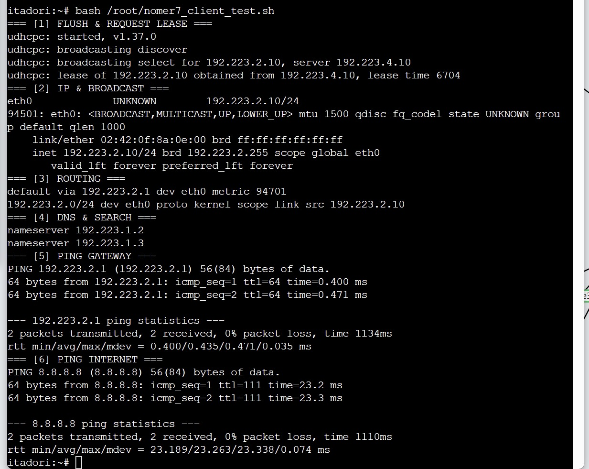
   * **fushiguro**: IP `192.223.2.11/24`, brd `192.223.2.255`, gw `192.223.2.1`.
   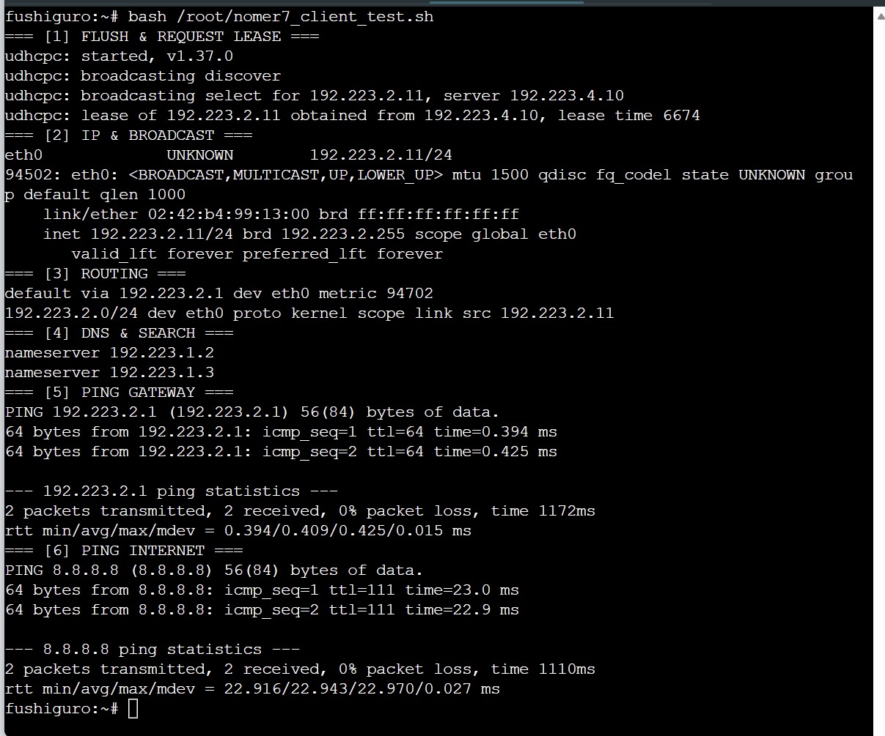
   * **zenin**: IP `192.223.2.70/24`, brd `192.223.2.255`, gw `192.223.2.1`.
   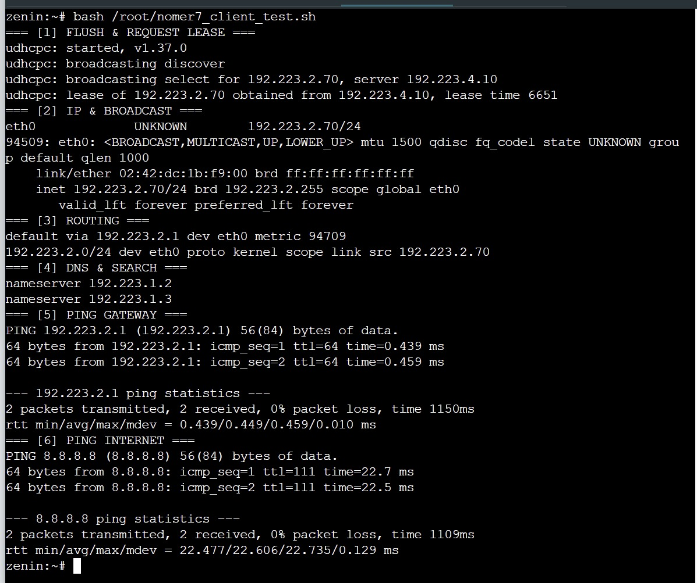
   * **okkotsu**: IP `192.223.2.71/24`, brd `192.223.2.255`, gw `192.223.2.1`.
   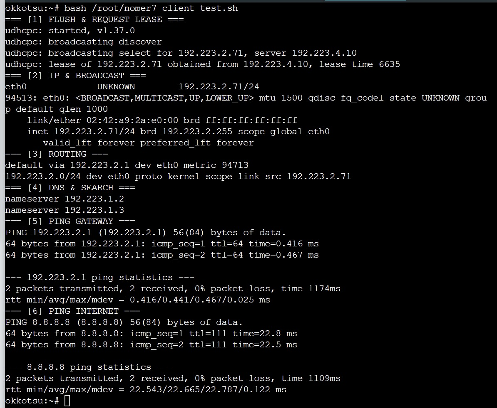

2. **Audit Lengkap Klien Divisi B (ino, kusakabe, miwa, kugisaki)**:
   * **ino**: IP `192.223.3.10/24`, brd `192.223.3.255`, gw `192.223.3.1`, lease 1800s.
   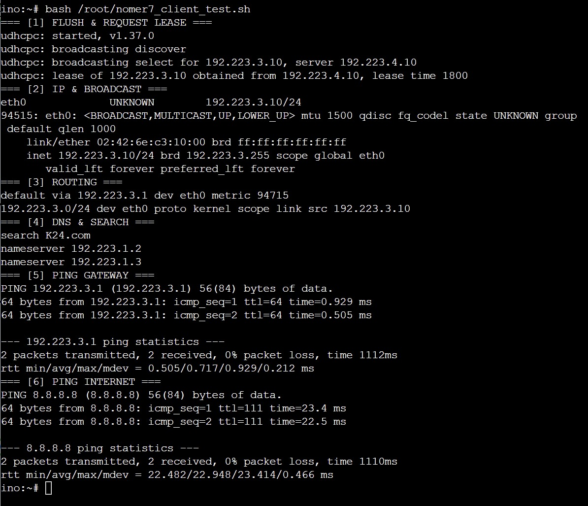

3. **Verifikasi Database Lease pada Server tengen**:
   * Seluruh sewa aktif tercatat rapi pada `/var/lib/dhcp/dhcpd.leases` dan sinkron dengan IP aktual pada klien tanpa ada tabrakan alamat.
   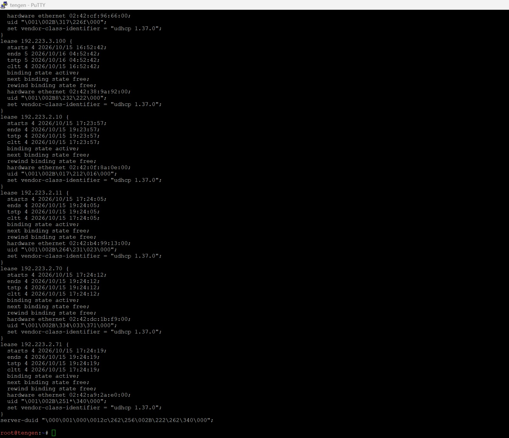

---

### Soal 8

> Sebelum Curtain dibuka kembali, buktikan bahwa proses pemberian alamat berjalan sesuai protokol. Lakukan packet capture saat salah satu client Network 2 atau Network 3 meminta lease baru. Gunakan tcpdump pada tengen atau jalur menuju Data Center untuk menunjukkan urutan DHCPDISCOVER -> DHCPOFFER -> DHCPREQUEST -> DHCPACK. Identifikasi alamat server, alamat yang diberikan, lease time, dan field giaddr. Pastikan nilai giaddr sesuai dengan interface jichi yang menerima request dari subnet client.

### Maksud dari Soal No. 8
Soal ini bertujuan untuk membuktikan mekanisme kerja protokol DHCP secara mendalam pada level paket (Layer 3 dan Layer 7) melalui teknik penangkapan paket (*packet capture* / `tcpdump`). Praktikan harus mendokumentasikan siklus empat langkah protokol DHCP yang dikenal sebagai **DORA**:
1. **DHCPDISCOVER**: Klien membroadcast permintaan mencari server DHCP.
2. **DHCPOFFER**: Server menawarkan konfigurasi alamat IP ke klien.
3. **DHCPREQUEST**: Klien menerima tawaran dan meminta sewa resmi.
4. **DHCPACK**: Server mengonfirmasi pemberian hak sewa.

Khusus untuk jaringan yang menggunakan DHCP Relay, paket DISCOVER dan REQUEST yang sampai ke server memuat informasi khusus pada field **`giaddr` (Gateway IP Address)**. Nilai `giaddr` ini wajib cocok dengan IP interface router jichi tempat client terhubung (`192.223.2.1` untuk Network 2 atau `192.223.3.1` untuk Network 3).

### Cara Mengerjakan

1. **Pemasangan `tcpdump`**:
   Memastikan utilitas `tcpdump` terpasang pada server tengen.

2. **Pembuatan Skrip Penangkapan Paket pada tengen**:
   Seluruh prosedur disimpan di `/root/nomer8_config.sh` pada node tengen.

   Isi skrip `/root/nomer8_config.sh` pada node **tengen**:
   ```bash
   #!/bin/bash
   # Packet Capture Analisis Protokol DHCP (DORA & giaddr)

   PCAP_FILE="/root/nomer8_capture.pcap"
   COUNT="${1:-4}"

   # 1. Pastikan tcpdump terpasang
   if ! command -v tcpdump >/dev/null 2>&1; then
       echo "[*] Menginstall tcpdump..."
       apt-get update
       DEBIAN_FRONTEND=noninteractive apt-get install -y tcpdump
   fi

   echo "=========================================================="
   echo "[*] Menjalankan tcpdump pada eth0 (Filter: port 67 or 68)"
   echo "[*] Target penangkapan: $COUNT paket DHCP..."
   echo "[*] File capture disimpan di: $PCAP_FILE"
   echo "=========================================================="
   rm -f "$PCAP_FILE"

   # Jalankan tcpdump untuk menangkap paket
   tcpdump -i eth0 -n -v -c "$COUNT" -w "$PCAP_FILE" "port 67 or port 68"

   echo ""
   echo "=========================================================="
   echo "[*] Hasil Analisis Paket DHCP dari File PCAP:"
   echo "=========================================================="
   tcpdump -nr "$PCAP_FILE" -v

   echo ""
   echo "[+] Analisis Packet Capture Soal 8 Selesai."
   ```

3. **Pembuatan Skrip Request Klien**:
   Disimpan di `/root/nomer8_client_request.sh` pada client Network 2 (`itadori`) dan Network 3 (`ino`).

   Isi skrip `/root/nomer8_client_request.sh` pada node **client**:
   ```bash
   #!/bin/sh
   # Memicu Request DHCP untuk Analisis Packet Capture

   echo "=========================================================="
   echo "[*] [1] Melepaskan Konfigurasi IP Lama pada eth0..."
   echo "=========================================================="
   ip addr flush dev eth0

   echo "=========================================================="
   echo "[*] [2] Mengirim DHCP Discover Baru via udhcpc..."
   echo "=========================================================="
   udhcpc -i eth0 -n -q

   echo ""
   echo "=========================================================="
   echo "[*] [3] Konfigurasi Interface eth0 Saat Ini:"
   echo "=========================================================="
   ip -br a show dev eth0
   ip addr show dev eth0

   echo ""
   echo "[+] Permintaan lease selesai. Periksa tangkapan paket di server tengen."
   ```

### Cara Melakukan Validasi

1. **Penangkapan Paket DORA Network 2 (itadori)**:
   * Jalankan `/root/nomer8_config.sh 4` pada tengen, lalu jalankan `/root/nomer8_client_request.sh` pada itadori.
   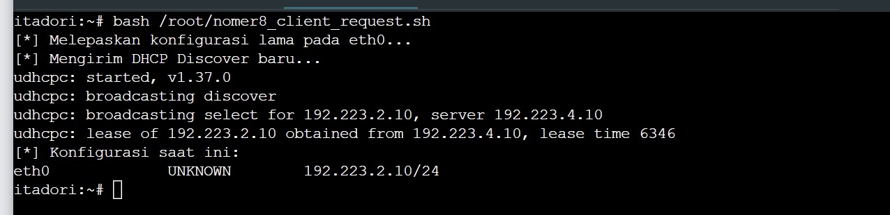
   * Hasil tangkapan tcpdump pada tengen menampilkan 4 paket lengkap (Discover, Offer, Request, ACK), dengan:
     * **`Gateway-IP (giaddr)`**: `192.223.2.1` (Interface `eth2` jichi).
     * **`Your-IP`**: `192.223.2.10`.
     * **`Server-ID`**: `192.223.4.10`.
   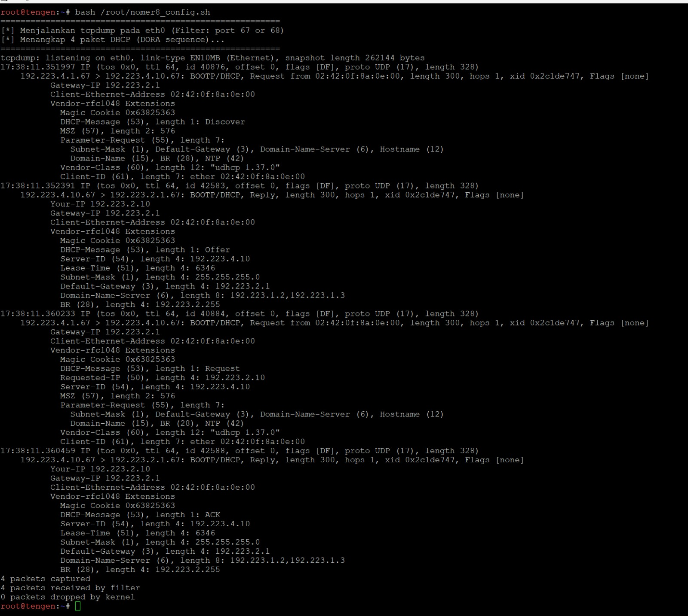

2. **Penangkapan Paket DORA Network 3 (ino)**:
   * Jalankan `/root/nomer8_config.sh 4` pada tengen, lalu jalankan `/root/nomer8_client_request.sh` pada ino.
   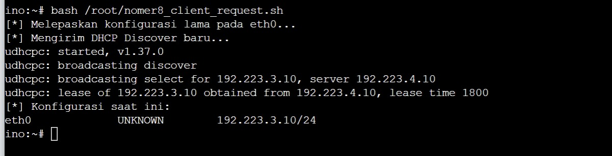
   * Hasil tangkapan tcpdump pada tengen menampilkan 4 paket lengkap, dengan:
     * **`Gateway-IP (giaddr)`**: `192.223.3.1` (Interface `eth3` jichi).
     * **`Your-IP`**: `192.223.3.10`.
     * **`Lease-Time`**: `1800` detik (Short Lease).
     * **`Domain-Name`**: `K24.com`.
   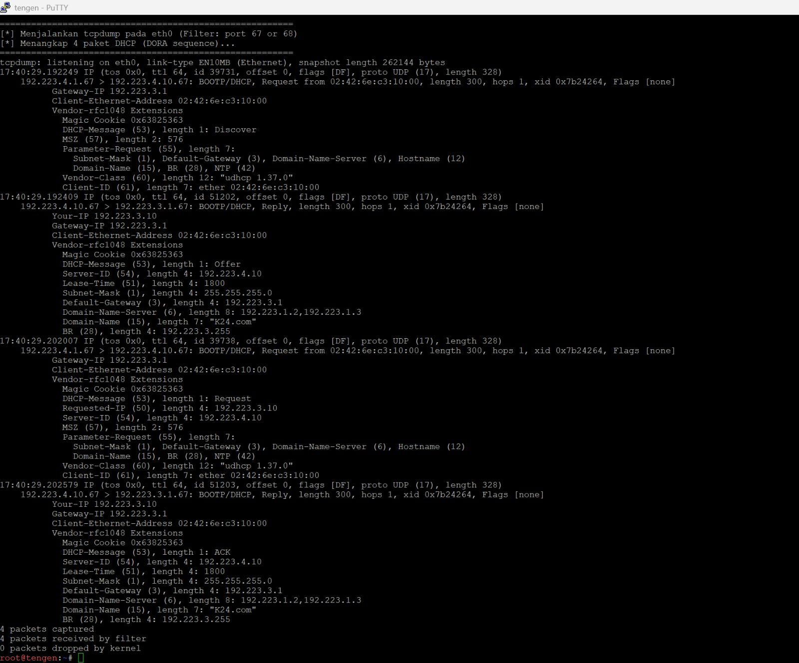

---

### Soal 9

> Sebuah gangguan memutus jalur relay dan membuat permintaan alamat tidak sampai ke Data Center. Hentikan service DHCP Relay pada jichi, lalu paksa salah satu client di Network 2 atau Network 3 meminta lease baru dan catat gejalanya. Pulihkan service relay, ulangi permintaan DHCP, lalu buktikan bahwa client kembali memperoleh alamat dari pool yang benar dengan gateway semula.

### Maksud dari Soal No. 9
Soal ini bertujuan untuk menguji keandalan sistem (*reliability test*) serta mendokumentasikan gejala gangguan (*failure symptoms*) ketika terjadi putusnya layanan DHCP Relay. Praktikan harus membuktikan bahwa ketiadaan agen relay menyebabkan paket broadcast penemuan alamat dari client tidak dapat mencapai server di Data Center, sehingga client mengalami kegagalan (*DHCP timeout*). Selanjutnya, praktikan harus membuktikan bahwa setelah layanan relay dipulihkan kembali, seluruh proses alokasi alamat kembali normal tanpa distorsi konfigurasi rute maupun gateway.

### Cara Mengerjakan

1. **Pembuatan Skrip Kontrol Relay pada jichi**:
   Disimpan di `/root/nomer9_config.sh` pada router jichi.

   Isi skrip `/root/nomer9_config.sh` pada node **jichi**:
   ```bash
   #!/bin/bash
   # Simulasi Gangguan & Pemulihan DHCP Relay pada jichi

   ACTION="${1:-status}"

   case "$ACTION" in
       stop)
           echo "=========================================================="
           echo "[*] Menghentikan service DHCP Relay (dhcrelay)..."
           echo "=========================================================="
           pkill -9 dhcrelay 2>/dev/null
           sleep 1
           echo "[+] Status setelah dihentikan:"
           ps aux | grep dhcrelay | grep -v grep || echo "[-] dhcrelay TIDAK AKTIF (Berhasil Dihentikan)"
           ;;
       start|restore)
           echo "=========================================================="
           echo "[*] Memulihkan / Menjalankan service DHCP Relay..."
           echo "=========================================================="
           pkill -9 dhcrelay 2>/dev/null
           sleep 1
           /usr/sbin/dhcrelay -q -i eth2 -i eth3 -i eth4 192.223.4.10
           sleep 1
           echo "[+] Status setelah dipulihkan:"
           ps aux | grep dhcrelay | grep -v grep
           if pgrep -f "dhcrelay" >/dev/null 2>&1; then
               echo "[+] dhcrelay BERHASIL dipulihkan dan aktif melayani eth2, eth3, eth4."
           else
               echo "[-] Gagal memulihkan dhcrelay!"
           fi
           ;;
       status)
           echo "=========================================================="
           echo "[*] Status Layanan DHCP Relay Saat Ini:"
           echo "=========================================================="
           ps aux | grep dhcrelay | grep -v grep || echo "[-] dhcrelay TIDAK AKTIF"
           ;;
       *)
           echo "Penggunaan: $0 {stop|start|restore|status}"
           exit 1
           ;;
   esac
   ```

2. **Pembuatan Skrip Uji Coba Klien**:
   Disimpan di `/root/nomer9_client_test.sh` pada client Network 2 (`itadori`) dan Network 3 (`ino`).

   Isi skrip `/root/nomer9_client_test.sh` pada node **client**:
   ```bash
   #!/bin/sh
   # Uji Coba Gejala Gangguan & Pemulihan pada Client

   echo "=========================================================="
   echo "=== [1] FLUSH & REQUEST LEASE ==="
   echo "=========================================================="
   ip addr flush dev eth0
   udhcpc -i eth0 -n -q
   STATUS=$?

   if [ $STATUS -ne 0 ]; then
       echo "[-] GAGAL MEMPEROLEH LEASE DARI DHCP SERVER (Relay Terputus / Outage Terkonfirmasi)"
   else
       echo "[+] BERHASIL MEMPEROLEH LEASE DARI DHCP SERVER (Relay Berfungsi / Recovery Terkonfirmasi)"
   fi

   echo ""
   echo "=========================================================="
   echo "=== [2] STATUS ALAMAT IP ==="
   echo "=========================================================="
   ip -br a show dev eth0
   ip a show dev eth0 | grep "inet " || echo "[-] Tidak ada alamat IPv4 yang terpasang."

   echo ""
   echo "=========================================================="
   echo "=== [3] ROUTING TABLE ==="
   echo "=========================================================="
   ip route show

   echo ""
   echo "=========================================================="
   echo "=== [4] DNS & SEARCH (/etc/resolv.conf) ==="
   echo "=========================================================="
   cat /etc/resolv.conf 2>/dev/null

   echo ""
   echo "=========================================================="
   echo "=== [5] PING GATEWAY ==="
   echo "=========================================================="
   GW=$(ip route show default | awk '{print $3}')
   if [ -n "$GW" ]; then
       ping -c 2 -W 2 "$GW"
   else
       echo "[-] Ping Gateway GAGAL: default route tidak ada (Network unreachable)."
   fi

   echo ""
   echo "=========================================================="
   echo "=== [6] PING INTERNET ==="
   echo "=========================================================="
   ping -c 2 -W 2 8.8.8.8 || echo "[-] Ping Internet GAGAL: Akses keluar terputus."
   ```

### Cara Melakukan Validasi

1. **Dokumentasi Penghentian Relay pada jichi**:
   * Menjalankan `/root/nomer9_config.sh stop` pada router jichi.
   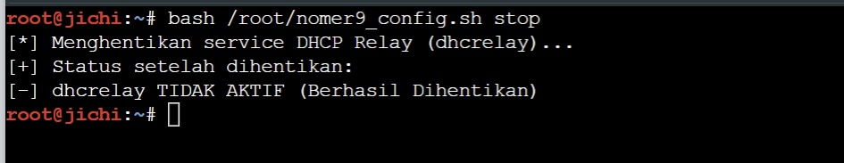

2. **Dokumentasi Gejala Kegagalan pada Klien (Outage)**:
   * Menjalankan `/root/nomer9_client_test.sh` pada itadori.
   * Terjadi timeout: `udhcpc: no lease, failing`, status IP kosong, dan uji ping menghasilkan error `ping: connect: Network unreachable`.
   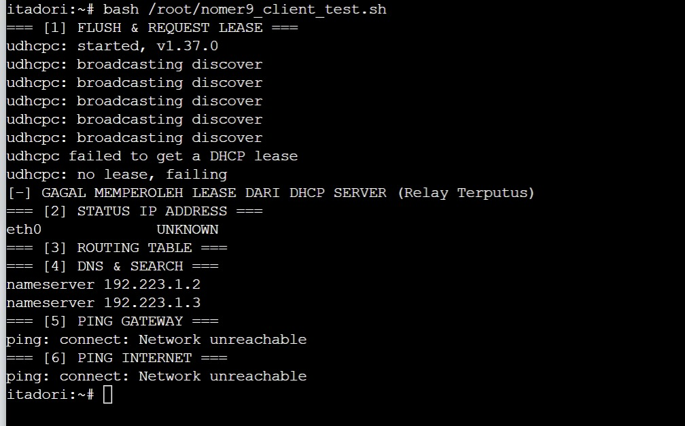

3. **Dokumentasi Pemulihan Relay pada jichi**:
   * Menjalankan `/root/nomer9_config.sh start` pada router jichi.
   * Service kembali aktif pada interface `eth2`, `eth3`, `eth4`.
   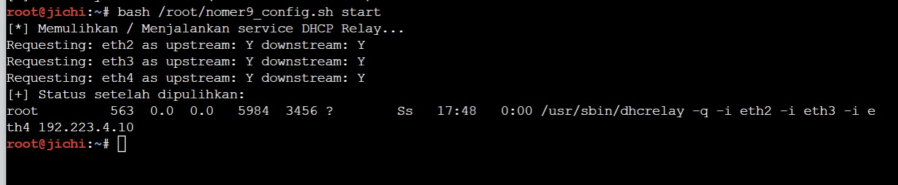

4. **Dokumentasi Pemulihan Konektivitas pada Klien (Recovery)**:
   * Menjalankan kembali `/root/nomer9_client_test.sh` pada itadori.
   * Klien langsung berhasil memperoleh kembali lease IP `192.223.2.10`, gateway `192.223.2.1`, dan ping internet pulih normal (0% packet loss).
   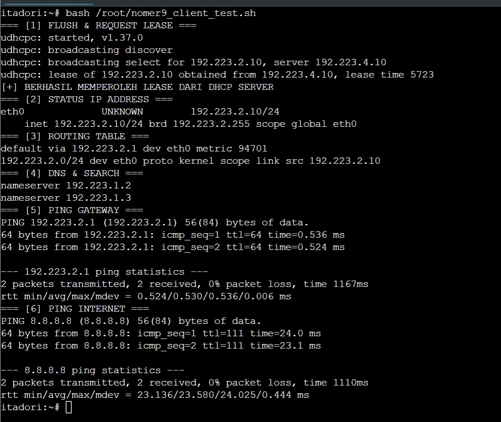

---

### Soal 10

> Setelah gangguan Shibuya tertangani, pastikan pemulihan bertahan setelah restart. Aktifkan autostart DHCP Server pada tengen dan DHCP Relay pada jichi, lalu restart kedua node. Verifikasi status layanan, IP, gateway, lease, dan konektivitas client Network 2-3. Pastikan kebijakan Pool 1, Pool 2, short lease, long lease, dan fixed address tetap berlaku.

### Maksud dari Soal No. 10
Pada lingkungan virtualisasi container (khususnya Docker di GNS3), proses container dapat kehilangan *state* runtime, interface virtual, atau proses background ketika node dimatikan (*Stop*) atau direstart (*Reload*). Soal ini menuntut implementasi mekanisme **Autostart yang Tangguh dan Persisten** pada kedua node infrastruktur utama (**jichi** dan **tengen**). Layanan DHCP Relay pada jichi dan DHCP Server pada tengen harus otomatis aktif kembali saat container booting tanpa memerlukan intervensi manual. Selain itu, dependensi paket Debian disimpan secara lokal (*offline cache*) agar node dapat memulihkan diri meskipun akses internet ke repositori eksternal belum siap.

### Cara Mengerjakan

1. **Implementasi Offline Package Caching**:
   Menyimpan file arsip `.deb` paket `isc-dhcp-server` dan `isc-dhcp-relay` ke direktori lokal `/root/cache/` pada masing-masing node. Dengan demikian, proses instalasi ulang dapat dilakukan secara lokal tanpa bergantung pada repositori eksternal saat booting.

2. **Konfigurasi Autostart Router jichi**:
   * Membuat skrip `/root/nomer10_config.sh` yang menetapkan seluruh IP interface `eth0`-`eth4`, default route, forwarding, NAT, dan menyalakan daemon `dhcrelay`.
   * Memasang pemanggilan skrip tersebut ke dalam entry point inisialisasi Debian `/root/init.sh` dan `/etc/debinet-init.sh`, serta `/root/.bashrc`.

   Isi skrip `/root/nomer10_config.sh` pada node **jichi**:
   ```bash
   #!/bin/bash
   # Autostart DHCP Relay & Jaringan Pasca Restart pada jichi

   echo "=========================================================="
   echo "[*] Inisialisasi Konfigurasi Jaringan & DHCP Relay pada jichi"
   echo "=========================================================="

   # 1. Pastikan IP Address dan Gateway WAN
   ip addr add 192.168.122.20/24 dev eth0 2>/dev/null
   ip link set eth0 up
   ip route replace default via 192.168.122.1 2>/dev/null

   # 2. Pastikan IP Interface Internal Network 1 - 4
   ip addr add 192.223.1.1/24 dev eth1 2>/dev/null && ip link set eth1 up
   ip addr add 192.223.2.1/24 dev eth2 2>/dev/null && ip link set eth2 up
   ip addr add 192.223.3.1/24 dev eth3 2>/dev/null && ip link set eth3 up
   ip addr add 192.223.4.1/24 dev eth4 2>/dev/null && ip link set eth4 up

   # 3. Aktifkan IPv4 Forwarding & NAT iptables
   sysctl -w net.ipv4.ip_forward=1 >/dev/null 2>&1
   iptables -t nat -C POSTROUTING -o eth0 -j MASQUERADE 2>/dev/null || iptables -t nat -A POSTROUTING -o eth0 -j MASQUERADE
   echo "nameserver 192.168.122.1" > /etc/resolv.conf

   # 4. Pastikan paket isc-dhcp-relay terpasang (Gunakan offline cache jika offline)
   if ! command -v dhcrelay >/dev/null 2>&1; then
       echo "[*] Menginstall isc-dhcp-relay dari cache atau repositori..."
       dpkg -i /root/cache/*.deb 2>/dev/null || (apt-get update && DEBIAN_FRONTEND=noninteractive apt-get install -y isc-dhcp-relay)
   fi

   # 5. Jalankan DHCP Relay jika belum aktif
   if ! pgrep -f "dhcrelay" >/dev/null 2>&1; then
       echo "[*] Menjalankan daemon dhcrelay..."
       /usr/sbin/dhcrelay -q -i eth2 -i eth3 -i eth4 192.223.4.10
       sleep 1
   fi

   echo "[+] Status Interface jichi:"
   ip -br a
   echo "[+] Status Layanan dhcrelay:"
   ps aux | grep dhcrelay | grep -v grep
   ```

3. **Konfigurasi Autostart Server tengen**:
   * Membuat skrip `/root/nomer10_config.sh` yang menetapkan IP `192.223.4.10`, default route ke `192.223.4.1`, menulis konfigurasi lengkap `/etc/dhcp/dhcpd.conf` (seluruh scope Soal 2, 4, 5, 6), dan menyalakan service `isc-dhcp-server`.
   * Memasang pemanggilan skrip tersebut ke dalam `/root/init.sh`, `/etc/debinet-init.sh`, dan `/root/.bashrc`.

   Isi skrip `/root/nomer10_config.sh` pada node **tengen**:
   ```bash
   #!/bin/bash
   # Autostart DHCP Server Lengkap Pasca Restart pada tengen

   echo "=========================================================="
   echo "[*] Inisialisasi Konfigurasi Jaringan & DHCP Server pada tengen"
   echo "=========================================================="

   # 1. Pastikan IP statis dan default gateway
   ip addr add 192.223.4.10/24 dev eth0 2>/dev/null
   ip link set eth0 up
   ip route replace default via 192.223.4.1 2>/dev/null
   echo "nameserver 192.168.122.1" > /etc/resolv.conf

   # 2. Pastikan paket isc-dhcp-server terinstall
   if ! command -v dhcpd >/dev/null 2>&1; then
       echo "[*] Menginstall isc-dhcp-server dari cache atau repositori..."
       dpkg -i /root/cache/*.deb 2>/dev/null || (apt-get update && DEBIAN_FRONTEND=noninteractive apt-get install -y isc-dhcp-server)
   fi

   # 3. Konfigurasi INTERFACESv4
   sed -i 's/^INTERFACESv4=.*/INTERFACESv4="eth0"/' /etc/default/isc-dhcp-server 2>/dev/null
   grep -q '^INTERFACESv4=' /etc/default/isc-dhcp-server 2>/dev/null || echo 'INTERFACESv4="eth0"' >> /etc/default/isc-dhcp-server

   # 4. Tulis /etc/dhcp/dhcpd.conf lengkap
   mkdir -p /etc/dhcp
   cat << 'EOC' > /etc/dhcp/dhcpd.conf
   default-lease-time 7200;
   max-lease-time 14400;
   ddns-update-style none;
   authoritative;

   # Klasifikasi Client Network 2 (Divisi A)
   class "dev-team" {
       match pick-first-value (option dhcp-client-identifier, hardware);
   }
   subclass "dev-team" 1:02:42:0f:8a:0e:00;    # itadori
   subclass "dev-team" 1:02:42:b4:99:13:00;  # fushiguro

   class "support-team" {
       match pick-first-value (option dhcp-client-identifier, hardware);
   }
   subclass "support-team" 1:02:42:dc:1b:f9:00;    # zenin
   subclass "support-team" 1:02:42:a9:2a:e0:00;  # okkotsu

   # Klasifikasi Client Network 3 (Divisi B)
   class "short-lease-team" {
       match pick-first-value (option dhcp-client-identifier, hardware);
   }
   subclass "short-lease-team" 1:02:42:6e:c3:10:00;       # ino
   subclass "short-lease-team" 1:02:42:cf:96:66:00;   # kusakabe

   class "long-lease-team" {
       match pick-first-value (option dhcp-client-identifier, hardware);
   }
   subclass "long-lease-team" 1:02:42:38:9a:92:00;       # miwa

   # Subnet Lokal Network 4 (Data Center)
   subnet 192.223.4.0 netmask 255.255.255.0 {
   }

   # Subnet Network 2 (Divisi A)
   subnet 192.223.2.0 netmask 255.255.255.0 {
       option routers 192.223.2.1;
       option subnet-mask 255.255.255.0;
       option broadcast-address 192.223.2.255;
       option domain-name-servers 192.223.1.2, 192.223.1.3;
       option domain-name "K24.com";
       option domain-search "K24.com";

       pool {
           allow members of "dev-team";
           deny members of "support-team";
           range 192.223.2.10 192.223.2.35;
       }

       pool {
           allow members of "support-team";
           deny members of "dev-team";
           range 192.223.2.70 192.223.2.95;
       }
   }

   # Subnet Network 3 (Divisi B)
   subnet 192.223.3.0 netmask 255.255.255.0 {
       option routers 192.223.3.1;
       option subnet-mask 255.255.255.0;
       option broadcast-address 192.223.3.255;
       option domain-name-servers 192.223.1.2, 192.223.1.3;
       option domain-name "K24.com";
       option domain-search "K24.com";

       pool {
           allow members of "short-lease-team";
           deny members of "long-lease-team";
           range 192.223.3.10 192.223.3.89;
           default-lease-time 1800;
           max-lease-time 1800;
       }

       pool {
           allow members of "long-lease-team";
           deny members of "short-lease-team";
           range 192.223.3.100 192.223.3.199;
           default-lease-time 43200;
           max-lease-time 43200;
       }

       host kugisaki {
           hardware ethernet 02:42:0b:96:7a:00;
           fixed-address 192.223.3.99;
       }
   }
   EOC

   # 5. Jalankan service jika belum aktif
   if ! pgrep -f "dhcpd" >/dev/null 2>&1; then
       echo "[*] Menjalankan service isc-dhcp-server..."
       service isc-dhcp-server restart >/dev/null 2>&1
       sleep 2
   fi

   echo "[+] Status Layanan dhcpd:"
   ps aux | grep dhcpd | grep -v grep
   ```

4. **Pembuatan File Boot Hook `/root/init.sh`**:
   Isi file `/root/init.sh` pada node **jichi** dan **tengen**:
   ```bash
   #!/bin/sh
   # Boot Hook Script
   if [ -x /root/nomer10_config.sh ]; then
       /root/nomer10_config.sh
   fi
   ```

5. **Pembuatan Skrip Verifikasi Klien Pasca Restart**:
   Disimpan di `/root/nomer10_client_verify.sh` pada seluruh client.

   Isi file `/root/nomer10_client_verify.sh` pada node **client**:
   ```bash
   #!/bin/sh
   # Skrip Verifikasi Pasca Restart pada Klien

   echo "=========================================================="
   echo "[*] [1] Melepaskan Konfigurasi Lama & Meminta Ulang Lease..."
   echo "=========================================================="
   ip addr flush dev eth0
   udhcpc -i eth0 -n -q

   echo ""
   echo "=========================================================="
   echo "[*] [2] Parameter Jaringan yang Diperoleh:"
   echo "=========================================================="
   ip -br a show dev eth0
   ip addr show dev eth0

   echo ""
   echo "=========================================================="
   echo "[*] [3] Tabel Routing Default Gateway:"
   echo "=========================================================="
   ip route show

   echo ""
   echo "=========================================================="
   echo "[*] [4] Konfigurasi DNS Resolver (/etc/resolv.conf):"
   echo "=========================================================="
   cat /etc/resolv.conf

   GW=$(ip route show default | awk '{print $3}')
   if [ -n "$GW" ]; then
       echo ""
       echo "=========================================================="
       echo "[*] [5] Uji Ping Gateway ($GW):"
       echo "=========================================================="
       ping -c 2 -W 2 "$GW"
   fi

   echo ""
   echo "=========================================================="
   echo "[*] [6] Uji Ping Internet (8.8.8.8):"
   echo "=========================================================="
   ping -c 2 -W 2 8.8.8.8
   ```

### Cara Melakukan Validasi

1. **Verifikasi Autostart pada tengen Pasca Restart**:
   * Setelah node tengen dinyalakan kembali, buka console dan periksa proses dengan `ps aux | grep dhcpd`.
   * Daemon `dhcpd` langsung aktif berjalan secara otomatis tanpa intervensi perintah manual.
   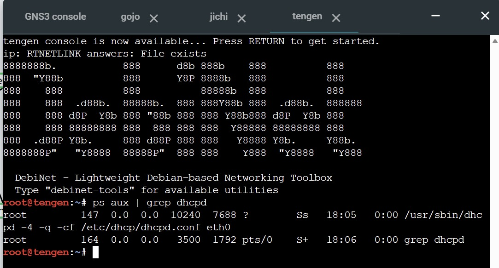

2. **Verifikasi Autostart pada jichi Pasca Restart**:
   * Setelah node jichi dinyalakan kembali, buka console dan periksa proses dengan `ps aux | grep dhcrelay`.
   * Daemon `dhcrelay` langsung aktif berjalan secara otomatis meneruskan traffic interface `eth2`, `eth3`, `eth4`.
   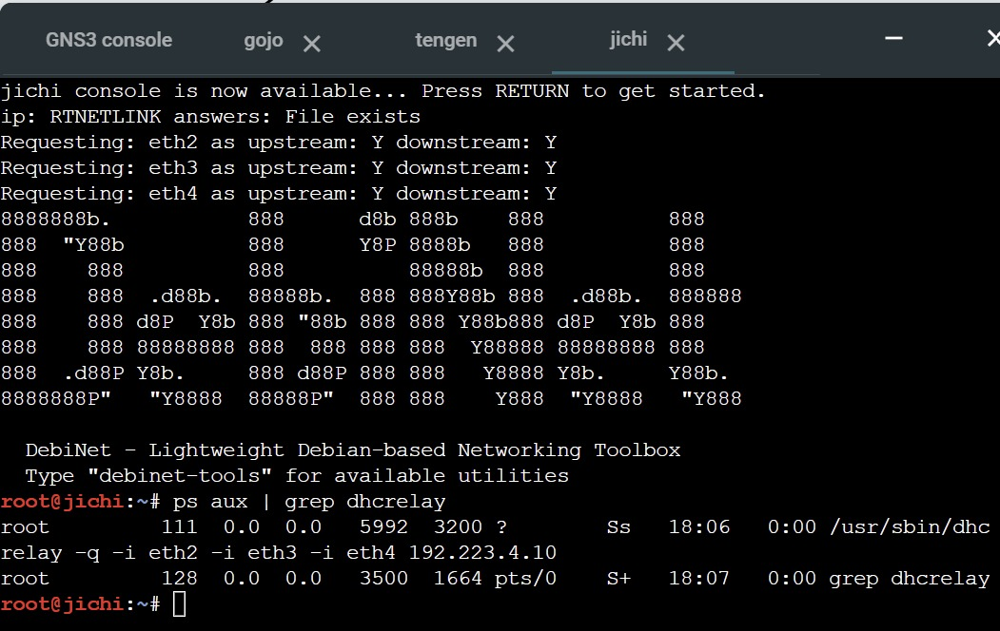

3. **Verifikasi Rekapitulasi Menyeluruh Klien Pasca Restart**:
   * Jalankan `cat /root/nomer10_verifikasi.log` pada tengen untuk melihat tabel hasil audit pasca restart.
   * Seluruh 8 klien (itadori, fushiguro, zenin, okkotsu, ino, kusakabe, miwa, kugisaki) berstatus **SESUAI**, tidak ada tabrakan IP, dan seluruh kebijakan pool bertahan secara konsisten.
   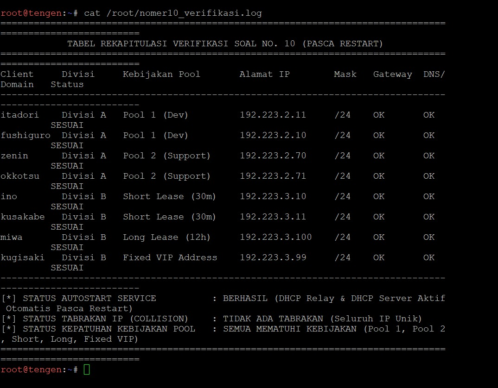
---
11. Utahime dan Shoko ditugaskan membangun sistem penamaan domain resmi agar seluruh pos tidak perlu menghafal alamat IP mentah. Konfigurasikan BIND9 pada utahime sebagai DNS Master dan shoko sebagai DNS Slave untuk mengelola domain jujutsu.<xxxx>.com. Atur SOA record, NS delegasi untuk kedua server, dan terapkan allow-transfer dari Master ke Slave. Pastikan file zona berhasil tersinkronisasi otomatis ke shoko saat nomor serial di utahime dinaikkan, lalu buktikan dengan melakukan query dig ke kedua server dari salah satu client.

Disini jalankan instalasi untuk BIND9-nya terlebih dahulu pada kedua node yaitu utahime dan shoko.

```
apt-get update
apt-get install -y bind9 bind9utils bind9-doc dnsutils
```
Kemudian buat direktori baru untuk menyimpan file zona agar nantinya bisa digunakan untuk konfigurasi SOA (Start of Authority) record dan NS (Nameserver) delegasi pada node utahime.

```
mkdir -p /etc/bind/jujutsu
```
Setelah itu konfigurasikan zona master dan allow-transfer ke direktori `/etc/bind/named.conf.local` di node utahime.
```
zone "jujutsu.k24.com" {
    type master;
    file "/etc/bind/jujutsu/jujutsu.k24.com";
    allow-transfer { 192.223.1.3; };
};
```
Kemudian konfigurasikan zona slave di direktori `/etc/bind/named.conf.local` di node shoko.
```
zone "jujutsu.k24.com" {
    type slave;
    file "/var/lib/bind/jujutsu.k24.com";
    masters { 192.223.1.2; };
};
```
Kemudian buat file zonenya dengan mengonfigurasikan SOA dan NS delegasinya ke direktori `/etc/bind/jujutsu/jujutsu.k24.com` di node utahime.
```
$TTL    604800
@       IN      SOA     utahime.jujutsu.k24.com. admin.jujutsu.k24.com. (
                              2026101501 ; Serial
                                  604800 ; Refresh
                                   86400 ; Retry
                                 2419200 ; Expire
                                  604800 ) ; Negative Cache TTL
;
; Name Server Delegations
@       IN      NS      utahime.jujutsu.k24.com.
@       IN      NS      shoko.jujutsu.k24.com.

; A Records untuk Name Servers
utahime IN      A       192.223.1.2
shoko   IN      A       192.223.1.3
```
Setelah konfigurasi dibuat maka service named direstart dengan `service named restart`.

Untuk buktinya adalah sebagai berikut:

yang ini adalah pencarian server utahime.
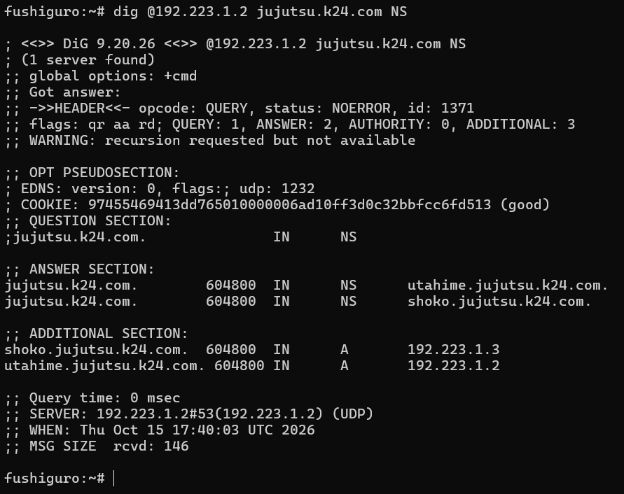

yang ini adalah pencarian server shoko.
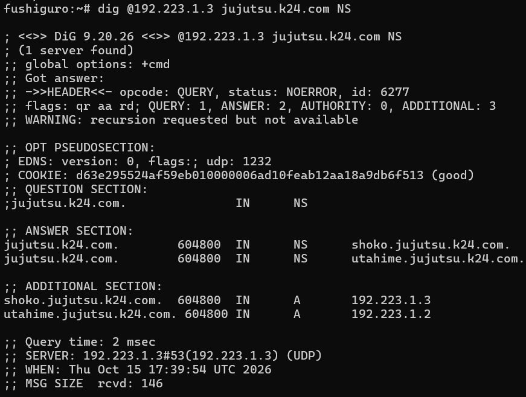

**notes: untuk penggunaan command bisa menggunakan `dig <@IP> <domain> A` untuk mencari host sesuai pemilik IP yang dicari.*

12. Peta domain harus memetakan pintu masuk utama dan tetap bisa mencari alamat di luar kawasan Shibuya. Pada utahime, buat A record jujutsu.<xxxx>.com yang mengarah ke gojo, serta CNAME www yang merujuk ke domain utama tersebut. Buat pula Reverse DNS (zona PTR) untuk melacak IP gojo kembali ke domain resminya, dan aktifkan fitur DNS Forwarder pada BIND9 mengarah ke IP gateway internet (192.168.122.1). Uji dari client dengan dig untuk mengecek CNAME, PTR, dan buktikan client tetap bisa melakukan ping ke domain internet seperti google.com.

Pertama lakukan konfigurasi DNS forwader di direktori `/etc/bind/named.conf.options`.

```
options {
        directory "/var/cache/bind";
        forwarders {
                192.168.122.1;
        };
        forward only;
        dnssec-validation auto;
        listen-on-v6 { any; };
};
```
Kemudian tambahkan A record dan CNAME pada file zone utama yang mengarah ke node gojo.
```
echo "jujutsu.k24.com. IN A 192.223.1.4" >> /etc/bind/jujutsu/jujutsu.k24.com
echo "www IN CNAME jujutsu.k24.com." >> /etc/bind/jujutsu/jujutsu.k24.com
```
Setelah itu, buat konfigurasi reverse zone di direktori `/etc/bind/named.conf.local`.
```
zone "1.223.192.in-addr.arpa" {
    type master;
    file "/etc/bind/jujutsu/1.223.192.rev";
    allow-transfer { 192.223.1.3; };
};
```
Terakhir, buat file reverse zone untuk IP gojo.
```
$TTL    604800
@       IN      SOA     utahime.jujutsu.k24.com. admin.jujutsu.k24.com. (
                              2026101503 ; Serial
                                  604800 ; Refresh
                                   86400 ; Retry
                                 2419200 ; Expire
                                  604800 ) ; Negative Cache TTL
;
@       IN      NS      utahime.jujutsu.k24.com.
@       IN      NS      shoko.jujutsu.k24.com.

4       IN      PTR     jujutsu.k24.com.
```
Setelah semuanya terkonfigurasi, restart layanan named dengan `service named restart`.

Untuk buktinya adalah sebagai berikut:

yang ini adalah pencarian domain www.jujutsu.k24.com.
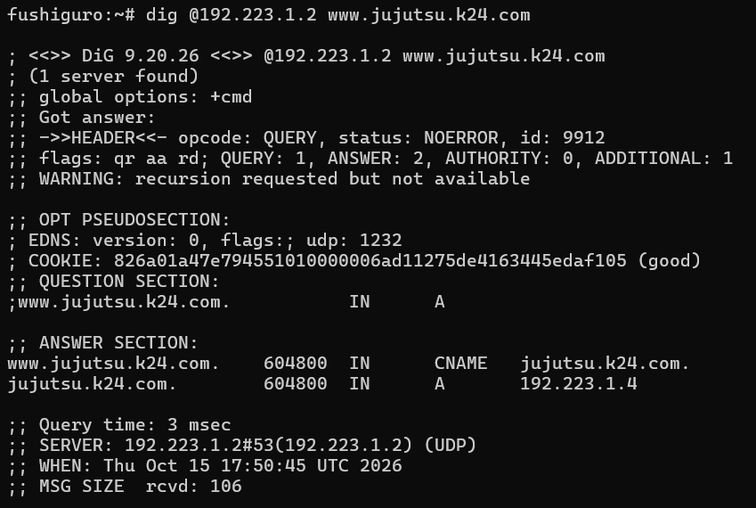

yang ini adalah pencarian reverse zone pada IP gojo.
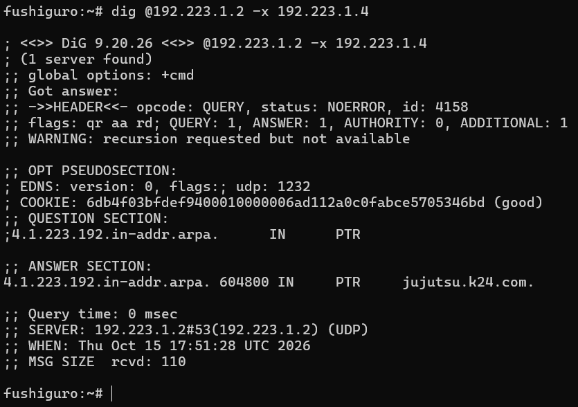

13. Kepala Sekolah Yaga dan Inumaki mendirikan database terpusat yang redundan agar log aktivitas kutukan tetap aman tersimpan. Konfigurasikan MariaDB pada yaga sebagai DB-Master dan inumaki sebagai DB-Slave. Buat database db_shibuya_<xxxx> beserta tabel request_logs di Master, aktifkan binary logging (log-bin, server-id), lalu hubungkan inumaki sebagai Slave yang menyalin data secara realtime dengan CHANGE MASTER TO. Berikan hak akses remote bagi seluruh node di Network 4, lalu buktikan replikasi berhasil dengan memasukkan data baru di Master dan memeriksa hasilnya di Slave.

Pertama-tama install terlebih dahulu mariadb di kedua node yaitu yaga dan inumaki.
```
apt-get update
apt-get install -y mariadb-server
```
Kemudian di node yaga, buat file konfigurasi khusus untuk pengaturan master di direktori `/etc/mysql/mariadb.conf.d/99-master.cnf`.
```
[mysqld]
bind-address = 0.0.0.0
server-id = 1
log_bin = /var/log/mysql/mysql-bin.log
```
Jangan lupa memastikan direktor log tersedia dengan kepemilikan user mysql.
```
mkdir -p /var/log/mysql
chown -R mysql:mysql /var/log/mysql
``` 
Setelah semua konfigurasi selesai restart dengan `service mariadb restart`.

Kemudian di node inumaki, buat file konfigurasi khusus untuk slave pada direktori `/etc/mysql/mariadb.conf.d/99-slave.cnf`.
```
[mysqld]
bind-address = 0.0.0.0
server-id = 2
```
Kemudian restart layanan mariadb dengan `service mariadb restart`.

Kembali ke node yaga, masuk ke database dengan `mysql -u root`.

Selanjutnya buat query sebagai berikut:
```
CREATE DATABASE IF NOT EXISTS db_shibuya_k24;
USE db_shibuya_k24;

-- Membuat tabel request_logs
CREATE TABLE IF NOT EXISTS request_logs (
    id INT AUTO_INCREMENT PRIMARY KEY,
    client_ip VARCHAR(50) NOT NULL,
    request_time TIMESTAMP DEFAULT CURRENT_TIMESTAMP
);

-- Membuat user untuk replikasi Slave
CREATE USER IF NOT EXISTS 'replica_user'@'%' IDENTIFIED BY 'Jujutsu2026';
GRANT REPLICATION SLAVE ON *.* TO 'replica_user'@'%';

-- Memberikan hak akses remote bagi seluruh node di Network 4
CREATE USER IF NOT EXISTS 'worker'@'192.223.4.%' IDENTIFIED BY 'Worker2026';
GRANT ALL PRIVILEGES ON db_shibuya_k24.* TO 'worker'@'192.223.4.%';

FLUSH PRIVILEGES;
```
Kemudian jalankan query `SHOW MASTER STATUS` untuk mendapatkan nilai dari kolom file dan posisinya untuk dimasukkan nilainya saat mengonfigurasi server slave (inumaki).
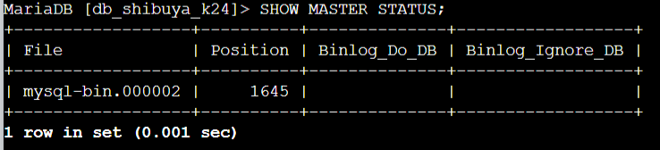
**notes: nilai dari kolom file dan position biasanya random jadi sesuaikan dengan nilai yang ada di dbmaster.*

Selanjutnya pindah ke node inumaki. Masuk ke dalam database dengan `mysql -u root`. Kemudian masukkan query berikut:
```
STOP SLAVE;
CHANGE MASTER TO
    MASTER_HOST='192.223.4.8',
    MASTER_USER='replica_user',
    MASTER_PASSWORD='Jujutsu2026',
    MASTER_LOG_FILE='mysql-bin.000001',
    MASTER_LOG_POS=1698;
START SLAVE;
```
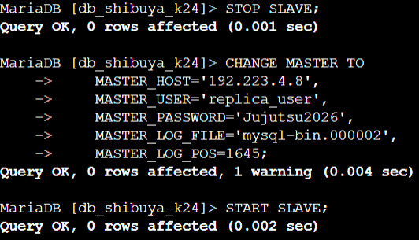

Untuk uji coba apakah node inumaki sudah bisa menyalin data dari node yaga maka kita lakukan query berikut di node yaga:
```
USE db_shibuya_k24;
INSERT INTO request_logs (client_ip) VALUES ('192.223.2.15');
```


Kemudian cek hasilnya di node inumaki:
```
USE db_shibuya_k24;
SELECT * FROM request_logs;
```

Bisa dilihat kalau node inumaki berhasil mereplikasi data yang ada pada node yaga.

14. Para penyihir lapangan bersiaga di Data Center sebagai pekerja backend untuk memproses aplikasi. Pasang Nginx dan PHP-FPM pada maki dan panda untuk menyajikan web frontend yang menampilkan hostname masing-masing. Pada nanami, todo, dan kirara, siapkan layanan API yang mencatat log request ke database yaga. Konfigurasikan virtual host agar worker merespons domain layanan yang ditentukan. Batasi akses langsung dari klien ke worker, web worker hanya menerima trafik melalui jalur proxy web yang ditentukan, sedangkan worker API hanya menerima trafik melalui geto. Uji bahwa akses langsung dari klien ditolak, sementara akses melalui reverse proxy tetap berhasil.

Pertama, lakukan instalasi Nginx dan PHP-FPM pada node maki dan panda.
```
apt-get update
apt-get install -y nginx php-fpm
```
Kemudian pastikan server PHP_FPM sudah aktif.
```
PHP_SERVICE=$(ls /etc/init.d/ | grep php | head -n 1)
service $PHP_SERVICE restart
```
Selanjutnya buat file index.php baru di direktori `/var/www/html/index.php`.
```
<?php
echo "Frontend Worker: " . gethostname() . "\n";
?>
```
Jangan lupa cek apakah socket PHP-FPM sudah jalan atau belum.
```
PHP_SOCK=$(find /run/php/ -name "*.sock" | head -n 1)
```
Selanjutnya buat konfigurasi Nginx baru yang hanya mengarahkan ke index.php pada direktori `/etc/nginx/sites-available/jujutsu-frontend`.
```
server {
    listen 80;
    server_name jujutsu.k24.com www.jujutsu.k24.com;

    root /var/www/html;
    index index.php;

    allow 192.223.1.4;
    deny all;

    location / {
        try_files \$uri \$uri/ /index.php\$is_args\$args;
    }

    location ~ \.php$ {
        include snippets/fastcgi-php.conf;
        fastcgi_pass unix:$PHP_SOCK;
    }
}
```
Lakukan semua konfigurasi pada kedua node maki dan panda.
Setelah semuanya selesai restart layanan dengan `service nginx restart`.

Sekarang beralih ke node nanami, todo, dan kirara. Lakukan instalasi Nginx, PHP-FPM dan PHP-mysql di ketiga node tersebut yaitu nanami, todo, dan kirara.
```
apt-get update
apt-get install -y nginx php-fpm php-mysql
```
Pastikan server PHP-FPM sudah aktif.
```
PHP_SERVICE=$(ls /etc/init.d/ | grep php | head -n 1)
service $PHP_SERVICE restart
```
Kemudian buat file konfigurasi mysql di direktori `/var/www/api/index.php`.
```
<?php
$db_host = "192.223.4.8";
$db_user = "worker";
$db_pass = "Worker2026";
$db_name = "db_shibuya_k24";

$client_ip = isset($_SERVER['HTTP_X_REAL_IP']) ? $_SERVER['HTTP_X_REAL_IP'] :
            (isset($_SERVER['HTTP_X_FORWARDED_FOR']) ? $_SERVER['HTTP_X_FORWARDED_FOR'] : $_SERVER['REMOTE_ADDR']);

$conn = new mysqli($db_host, $db_user, $db_pass, $db_name);
if (!$conn->connect_error) {
    $stmt = $conn->prepare("INSERT INTO request_logs (client_ip) VALUES (?)");
    $stmt->bind_param("s", $client_ip);
    $stmt->execute();
    $stmt->close();
    $conn->close();
}

header('Content-Type: application/json');
echo json_encode([
    "status" => "success",
    "worker" => gethostname(),
    "client_ip" => $client_ip
]) . "\n";
?>
```
Jangan lupa cek apakah socket PHP-FPM sudah jalan atau belum.
```
PHP_SOCK=$(find /run/php/ -name "*.sock" | head -n 1)
```
Selanjutnya buat konfigurasi Nginx API yang baru pada direktori `/etc/nginx/sites-available/jujutsu-api`.
```
server {
    listen 80;
    server_name jujutsu.k24.com;

    root /var/www/api;
    index index.php;

    allow 192.223.4.2;
    deny all;

    location / {
        try_files \$uri \$uri/ /index.php\$is_args\$args;
    }

    location ~ \.php$ {
        include snippets/fastcgi-php.conf;
        fastcgi_pass unix:$PHP_SOCK;
    }
}
```
Lakukan semua konfigurasi pada ketiga node nanami, todo, kirara.
Setelah semuanya selesai restart layanan dengan `service nginx restart`.

Untuk buktinya sebagai berikut:

yang ini ketika server diakses dari klien.
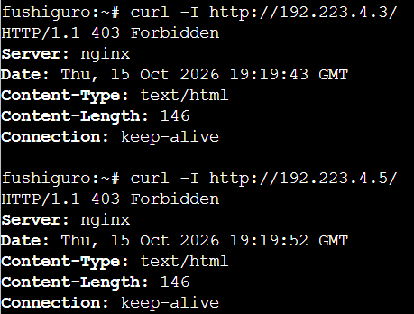

yang ini ketika server diakses melalui gojo.
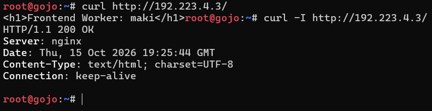

yang ini ketika server diakses melalui geto.
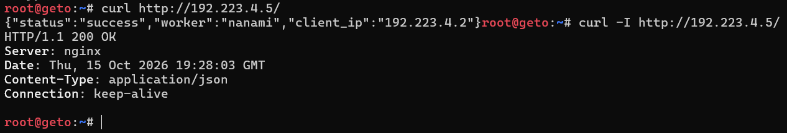

15. Geto bertugas mengendalikan pembagian beban request API di internal Data Center agar server tidak tumbang bersamaan. Konfigurasikan Nginx pada geto sebagai Load Balancer internal dengan upstream api_cluster yang mengarahkan trafik ke nanami dan todo. Terapkan algoritma Weighted Round Robin dengan bobot 3:1, di mana nanami menerima porsi beban tiga kali lebih banyak daripada todo. Buktikan distribusi beban ini dengan melakukan loop request berulang kali ke geto dari jaringan lokal Data Center dan periksa rasio responnya.

Pertama lakukan instalasi Nginx pada node geto.
```
apt-get update
apt-get install -y nginx
```
Selanjutnya konfigurasikan load balancer Nginx ke direktori `/etc/nginx/sites-available/api-lb`.
```
upstream api_cluster {
    server 192.223.4.5:80 weight=3; # nanami
    server 192.223.4.6:80 weight=1; # todo
}

server {
    listen 80;
    server_name jujutsu.k24.com;

    location / {
        proxy_pass http://api_cluster;
        proxy_set_header Host $host;
        proxy_set_header X-Real-IP $remote_addr;
        proxy_set_header X-Forwarded-For $proxy_add_x_forwarded_for;
    }
}
```
Setelah dikonfigurasi, restart layanan dengan `service nginx restart`.

Untuk buktinya sebagai berikut:


16. Gojo berdiri di perbatasan DMZ sebagai gerbang publik tunggal bagi seluruh client dari luar maupun dalam. Konfigurasikan Nginx pada gojo untuk melayani domain jujutsu.<xxxx>.com dan www.jujutsu.<xxxx>.com menggunakan metode Path-Based Routing. Atur agar request root (/) diteruskan secara Round Robin ke worker frontend (maki dan panda), sedangkan request ke path /api diteruskan langsung ke geto. Uji dari client Divisi A atau B bahwa akses ke web utama dibalas oleh Maki/Panda, sedangkan akses ke /api diteruskan dan dijawab oleh Nanami/Todo.

Pertama lakukan instalasi Nginx di node gojo.
```
apt-get update
apt-get install -y nginx
```
Kemudian buat konfigurasi untuk web worker yang meneruskan request root secara round robin ke worker frontend, sedangkan request ke path /api diteruskan ke geto. Taruh konfigurasi di direktori `/etc/nginx/sites-available/jujutsu-public`.
```
upstream web_frontend {
    server 192.223.4.3:80; # maki
    server 192.223.4.4:80; # panda
}

upstream api_gateway {
    server 192.223.4.2:80; # geto
}

server {
    listen 80;
    server_name jujutsu.k24.com www.jujutsu.k24.com;

    # Routing ke Frontend (Root /)
    location / {
        proxy_pass http://web_frontend;
        proxy_set_header Host $host;
        proxy_set_header X-Real-IP $remote_addr;
        proxy_set_header X-Forwarded-For $proxy_add_x_forwarded_for;
    }

    # Routing ke API (/api)
    location /api {
        proxy_pass http://api_gateway/;
        proxy_set_header Host $host;
        proxy_set_header X-Real-IP $remote_addr;
        proxy_set_header X-Forwarded-For $proxy_add_x_forwarded_for;
    }
}
```
Setelah semua terkonfigurasi lakukan restart layanan dengan `service nginx restart`.

Pastikan node klien di network 2 atau 3 sudah connect ke IP utahime.
```
echo "nameserver 192.223.1.2" > /etc/resolv.conf
```

Uji coba dengan command
```
for i in {1..4}; do curl http://jujutsu.k24.com/; done

curl http://jujutsu.k24.com/api
```
bukti:
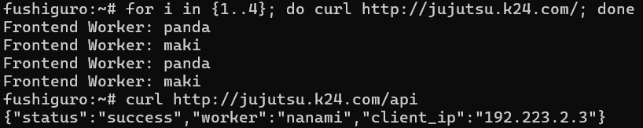

17. Komando pusat perlu mengetahui IP asli klien yang mengirimkan request tanpa tertukar dengan IP proxy perantara. Konfigurasikan gojo dan geto agar meneruskan informasi alamat klien melalui header X-Real-IP dan X-Forwarded-For. Pastikan geto hanya mempercayai informasi alamat klien yang diterima dari proxy terpercaya, dan skrip API menyimpan alamat klien yang telah diverifikasi ke kolom client_ip pada tabel request_logs di database yaga. Uji dengan mengirimkan request dari klien Network 2 dan Network 3 ke endpoint /api, kemudian periksa database untuk memastikan alamat yang tercatat sesuai dengan IP klien asal, bukan IP gojo atau geto.

Pertama masukkan script berikut di node geto:
```
#!/bin/bash

cat << 'EOF' > /etc/nginx/sites-available/api-lb
upstream api_cluster {
    server 192.223.4.5:80 weight=3; # nanami
    server 192.223.4.6:80 weight=1; # todo
}

server {
    listen 80;
    server_name jujutsu.k24.com;

    # Mempercayai header IP dari public reverse proxy (gojo)
    set_real_ip_from 192.223.1.4;
    real_ip_header X-Forwarded-For;
    real_ip_recursive on;

    location / {
        proxy_pass http://api_cluster;
        proxy_set_header Host $host;
        # $remote_addr sekarang berisi IP asli klien berkat real_ip_header
        proxy_set_header X-Real-IP $remote_addr;
        proxy_set_header X-Forwarded-For $proxy_add_x_forwarded_for;
    }
}
EOF

# Restart Nginx untuk menerapkan pengaturan baru
service nginx restart
```

Uji coba dengan command
```
# Di node fushiguro
curl http://jujutsu.k24.com/api

# Di node yaga
mysql -u root
USE db_shibuya_k24; SELECT * FROM request_logs;
```

Bukti:
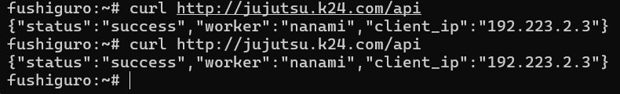


18. nanami dan todo merupakan worker API utama, sedangkan kirara disiapkan sebagai worker cadangan. Konfigurasikan upstream api_cluster pada geto agar kirara menjadi server backup, serta terapkan passive health check dengan parameter max_fails=2 dan fail_timeout=5s pada worker API utama. Pastikan kirara menjalankan layanan API yang kompatibel dengan endpoint utama. Simulasikan gangguan dengan menghentikan layanan Nginx atau layanan API pada nanami dan todo. Buktikan dari klien bahwa request ke /api dialihkan ke kirara dan menghasilkan respons API yang valid tanpa error 502 Bad Gateway.

Pertama masukkan script berikut di node geto:
```
#!/bin/bash

cat << 'EOF' > /etc/nginx/sites-available/api-lb
upstream api_cluster {
    server 192.223.4.5:80 weight=3 max_fails=2 fail_timeout=5s; # nanami (Utama)
    server 192.223.4.6:80 weight=1 max_fails=2 fail_timeout=5s; # todo (Utama)
    server 192.223.4.7:80 backup;                              # kirara (Cadangan)
}

server {
    listen 80;
    server_name jujutsu.k24.com;

    set_real_ip_from 192.223.1.4;
    real_ip_header X-Forwarded-For;
    real_ip_recursive on;

    location / {
        proxy_pass http://api_cluster;
        proxy_set_header Host $host;
        proxy_set_header X-Real-IP $remote_addr;
        proxy_set_header X-Forwarded-For $proxy_add_x_forwarded_for;
    }
}
EOF

# Restart Nginx
service nginx restart
```

Uji coba dengan command
```
# matikan layanan di kedua node nanami dan todo
service nginx stop

# Di node klien
curl http://jujutsu.k24.com/api
```

Bukti:


19. gojo bertugas mengoptimalkan layanan web sekaligus membatasi request berlebihan. Konfigurasikan Nginx Proxy Caching untuk halaman web frontend dengan masa berlaku cache 10 menit dan tambahkan header X-Cache-Status. Terapkan rate limiting pada path /api dengan batas 10 request per detik per IP klien. Buktikan bahwa request ke halaman web yang memenuhi syarat cache menghasilkan status MISS pada akses awal dan HIT pada akses berikutnya. Uji rate limiting secara terpisah dengan mengirimkan request beruntun ke /api, kemudian catat status respons yang dihasilkan ketika batas terlampaui.

Pertama masukkan script berikut di node gojo:
```
#!/bin/bash
apt-get update
apt-get install -y nginx

# Membuat direktori penyimpanan cache Nginx
mkdir -p /var/cache/nginx/jujutsu

cat << 'EOF' > /etc/nginx/sites-available/jujutsu-public
# Definisi Proxy Cache: zone web_cache dengan masa aktif 10m
proxy_cache_path /var/cache/nginx/jujutsu levels=1:2 keys_zone=web_cache:10m max_size=100m inactive=10m use_temp_path=off;

# Definisi Rate Limiting: 10 request per detik per IP klien
limit_req_zone $binary_remote_addr zone=api_limit:10m rate=10r/s;

upstream web_frontend {
    server 192.223.4.3:80; # maki
    server 192.223.4.4:80; # panda
}

upstream api_gateway {
    server 192.223.4.2:80; # geto
}

server {
    listen 80;
    server_name jujutsu.k24.com www.jujutsu.k24.com;

    # Menambahkan header X-Cache-Status untuk pemantauan cache
    add_header X-Cache-Status $upstream_cache_status;

    # 1. Routing Frontend (Root /) dengan Proxy Caching
    location / {
        proxy_pass http://web_frontend;
        proxy_set_header Host $host;
        proxy_set_header X-Real-IP $remote_addr;
        proxy_set_header X-Forwarded-For $proxy_add_x_forwarded_for;

        # Konfigurasi Cache 10 Menit
        proxy_cache web_cache;
        proxy_cache_valid 200 10m;
        proxy_cache_use_stale error timeout updating http_500 http_502 http_503 http_504;
    }

    # 2. Routing API (/api) dengan Rate Limiting 10r/s
    location /api {
        # Menerapkan aturan Rate Limit
        limit_req zone=api_limit nodelay;

        proxy_pass http://api_gateway/;
        proxy_set_header Host $host;
        proxy_set_header X-Real-IP $remote_addr;
        proxy_set_header X-Forwarded-For $proxy_add_x_forwarded_for;
    }
}
EOF

# Aktifkan konfigurasi
ln -sf /etc/nginx/sites-available/jujutsu-public /etc/nginx/sites-enabled/
rm -f /etc/nginx/sites-enabled/default

# Restart Nginx
service nginx restart
```

Uji coba dengan command
```
# Di node fushiguro
curl -I http://jujutsu.k24.com/

# akses kedua setelah miss
curl -I http://jujutsu.k24.com/

# pengujian rate limiting
for i in {1..20}; do curl -s -o /dev/null -w "%{http_code}\n" http://jujutsu.k24.com/api; done
```

Bukti:
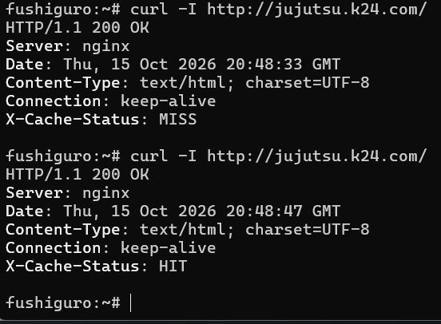


20. Sebelum Curtain di Shibuya resmi dibuka, Kusakabe memimpin audit untuk menguji kapasitas layanan. Dari terminal kusakabe, jalankan benchmark menggunakan Apache Benchmark dengan parameter -n 600 -c 30 menuju http://jujutsu.<xxxx>.com/. Catat Requests per Second (RPS), latensi, dan jumlah request yang gagal. Lakukan pengujian tambahan pada endpoint /api untuk mengamati efek rate limiting. Bandingkan hasil pengujian baseline dengan hasil ketika rate limiting aktif, serta gunakan access log gojo untuk membedakan kegagalan aplikasi, koneksi, dan request yang ditolak oleh kebijakan rate limit.

Pertama lakukan instalasi dengan command berikut:
```
apk update
apk add apache2-utils
```

Uji coba dengan command
```
ab -n 600 -c 30 http://jujutsu.k24.com/

ab -n 600 -c 30 http://jujutsu.k24.com/api

# Memeriksa jumlah request yang ditolak Rate Limit (HTTP 503):
grep " 503 " /var/log/nginx/access.log | wc -l

# Memeriksa detail pesan penolakan Rate Limit pada Error Log:
tail -n 20 /var/log/nginx/error.log

# Memeriksa respon sukses dari Cache vs API:
tail -n 50 /var/log/nginx/access.log
```
Bukti:


### REVISI

13. Terdapat kesalahan penulisan query pada node yaga sehingga menyebabkan tidak bisa menginput nilai ke tabel.
```
INSERT INTO request_logs (client_ip) VALUES ('192.223.2.3');
```
Seharusnya ada penambahan simbol petik (') saat menginput nilai di penulisan query.

Kemudian pada node inumaki seharusnya dibuat dulu databasenya
```
CREATE DATABASE IF NOT EXISTS db_shibuya_k24;
USE db_shibuya_k24;
CREATE TABLE IF NOT EXISTS request_logs (
    id INT AUTO_INCREMENT PRIMARY KEY,
    client_ip VARCHAR(50) NOT NULL,
    request_time TIMESTAMP DEFAULT CURRENT_TIMESTAMP
); 
```
baru melakukan query berikut:
```
STOP SLAVE;
CHANGE MASTER TO
   MASTER_HOST='192.223.4.8',
    MASTER_USER='replica_user',
    MASTER_PASSWORD='Jujutsu2026',
    MASTER_LOG_FILE='<sesuaikan nilainya>',
    MASTER_LOG_POS=<sesuaikan nilainya>;
START SLAVE;
```
Kalau database tidak dibuat, maka akan terjadi error database unknown saat percobaan pembuktian replikasi data.

Setelah diperbaiki:


16. Karena waktu demo tidak ada hasilnya maka ini adalah hasilnya


19. Karena waktu demo tidak ada hasilnya maka ini adalah hasilnya


Terakhir, waktu demo ada kesalahan penulisan konfigurasi penggunaan command
```
curl http://jujutsu.k24.com/api
```
yang menyebabkan tidak bisa dibuka karena tak bisa menemukan DNS service.

Seharusnya pada node klien, masukkan IP utahime sebagai DNS master bukan IP gojo.
```
echo "nameserver 192.223.1.2" > /etc/resolv.conf
```